# Rapport d'usage de l'IA 

## Informations générales
Biljana DJORDJEVIC M1 MIAGE

**Assistant IA utilisé** : Gemini 3.8 Flash (High) dans l'environnement Antigravity IDE

---

## Mission 0 — Cartographier l’application

### 1. Objectif
Comprendre l'architecture de départ sans modifier de code : identifier le composant racine, le routage, l'enregistrement de `HttpClient`, l'intercepteur JWT, les modèles et services, et produire le schéma de flux lors de la connexion ainsi que la distinction des routes publiques/protégées de l'API.

### 2. Prompt principal
> "Tu es mon assistant de développement pour ce projet AngularM1. Lis GEMINI.md, best-practices.md, README.md et API_CONTRACT.md. Analyse d'abord le code sans le modifier. Résume les fichiers concernés et le flux composant -> service -> HttpClient -> API. Indique les routes API et les modèles utilisés. Attends ma validation avant modification. Fais-moi Mission 0 Cartographier l'application."

### 3. Plan proposé par l'agent
1. Exploration de l'arborescence (`src/app/components`, `src/app/shared`).
2. Identification des points pivots : `main.ts`, `routes.ts`, `auth.interceptor.ts`, `auth.service.ts`.
3. Synthèse tabulaire des composants, services, modèles et guards.
4. Classification des routes de `API_CONTRACT.md` (publiques vs protégées par JWT).
5. Élaboration du diagramme de séquence Mermaid pour le clic sur « Se connecter ».

### 4. Vérifications réalisées
* Contrôle manuel de `main.ts` pour confirmer la présence de `provideHttpClient(withInterceptors([authInterceptor]))`.
* Vérification de `proxy.conf.json` pour s'assurer que `/api` pointe vers `http://localhost:3000`.
* Test de santé de l'API backend : `curl http://localhost:3000/api/health` renvoyant `{"status":"ok"}`.
* Archivage de la synthèse dans le document de référence `TP1Mission0.md`.

### 5. Erreurs ou propositions rejetées
* Aucune modification de code effectuée conformément à la règle stricte d'observation préalable.

### 6. Fichiers consultés (aucun fichier modifié)
* `frontend-starter/src/main.ts`
* `frontend-starter/src/app/routes.ts`
* `frontend-starter/src/app/shared/interceptors/auth.interceptor.ts`
* `frontend-starter/src/app/shared/services/auth.service.ts`
* `frontend-starter/src/app/shared/services/track.service.ts`
* `frontend-starter/src/app/shared/models/*`
* `API_CONTRACT.md`, `README.md`, `backend/src/app.js`

### 7. Preuve de fonctionnement et cartographie détaillée

#### A. Cartographie de l’architecture frontend
| Élément | Emplacement & Description |
| :--- | :--- |
| **Composant racine** | `AppComponent` (`app-root`), défini avec son template `app.html` et son style `app.css`. Il contient l’en-tête commun et le `<router-outlet />`. Démarré dans `main.ts`. |
| **Configuration des routes** | `routes` : fourni au bootstrap via `provideRouter(routes)` dans `main.ts`. Définit `/login`, `/register`, `/profile` (gardé), `/tracks` (gardé) et une redirection par défaut vers `/tracks`. |
| **Enregistrement de HttpClient** | Configuré dans `main.ts` avec :<br/>`provideHttpClient(withInterceptors([authInterceptor]))` |
| **Mécanisme d’injection du JWT** | `authInterceptor` : intercepteur fonctionnel (`HttpInterceptorFn`) qui injecte `AuthService`, lit le signal `token()` et clone la requête avec l’en-tête `Authorization: Bearer <token>` si un token est présent. |

#### B. Pages, Services, Modèles et Guards
* **Pages (Composants) :**
  * `LoginPageComponent` : formulaire de connexion réactif.
  * `RegisterPageComponent` : formulaire d'inscription.
  * `ProfilePageComponent` : affichage et modification du profil.
  * `TracksPageComponent` : liste paginée, upload et lecture audio.
* **Services :**
  * `AuthService` : gère `login()`, `register()`, `profile()`, `update()`, `logout()`, et détient les signals `currentUser` et `token`.
  * `TrackService` : encapsule les appels HTTP pour les pistes (`list()`, `upload()`, `audio()`).
* **Modèles :**
  * `User` (`id`, `name`, `email`, `createdAt`)
  * `AuthResponse` (`token`, `user`)
  * `Track` (`id`, `title`, `originalName`, `mimeType`, `size`, `createdAt`)
  * `Page` (`items`, `page`, `limit`, `total`, `pages`)
* **Guard :**
  * `authGuard` : vérifie `auth.token()` avant d’activer `/profile` ou `/tracks`, sinon redirige vers `/login`.

#### C. Routes API : Publiques vs Protégées (`API_CONTRACT.md`)
Toutes les requêtes sont préfixées par `/api` (redirigées vers le backend via `proxy.conf.json`).

| Statut | Méthode | Route | Corps / Paramètres | Réponse | Modèle associé |
| :--- | :--- | :--- | :--- | :--- | :--- |
| **Publique** | `GET` | `/api/health` | Aucun | `{ status: "ok" }` | — |
| **Publique** | `POST` | `/api/auth/register` | `{ name, email, password }` | `201 { token, user }` | `AuthResponse` |
| **Publique** | `POST` | `/api/auth/login` | `{ email, password }` | `200 { token, user }` | `AuthResponse` |
| **Protégée (JWT)** | `GET` | `/api/users/me` | Aucun *(Header Authorization)* | `200 User` | `User` |
| **Protégée (JWT)** | `PUT` | `/api/users/me` | `{ name }` + Header *Authorization* | `200 User` | `User` |
| **Protégée (JWT)** | `GET` | `/api/tracks` | Query: `?page=1&limit=5` + Header *Authorization* | `200 Page<Track>` | `Page` |
| **Protégée (JWT)** | `POST` | `/api/tracks` | Multipart : `audio`, `title` + Header *Authorization* | `201 Track` | `Track` |
| **Protégée (JWT)** | `GET` | `/api/tracks/:id/audio` | Header *Authorization* | Flux audio (`Blob`) | `Blob` |
| **Protégée (JWT)** | `DELETE` | `/api/tracks/:id` | Header *Authorization* | `204 No Content` | — |

#### D. Schéma annoté du flux lors du clic sur « Se connecter »
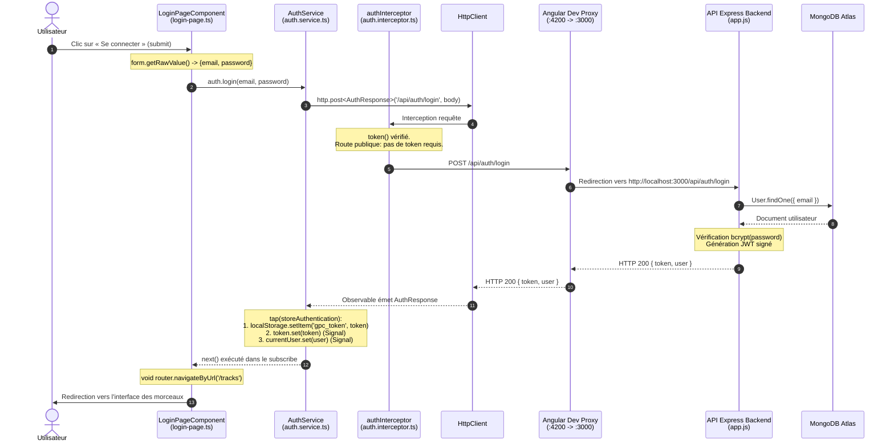

### 8. Ce que je sais expliquer sans l'agent
* Le trajet d'une requête HTTP depuis le composant Angular jusqu'à MongoDB via le service, `HttpClient`, l'intercepteur et le proxy.
* La différence entre route publique (`/api/auth/login`, `/api/auth/register`, `/api/health`) et route protégée par `Authorization: Bearer <token>` (`/api/users/me`, `/api/tracks`).

---

## Mission 1 — Inscription, Connexion et Profil

### 1. Objectif
Compléter la partie utilisateur du frontend :
* Formulaires réactifs pour la connexion et l'inscription avec validations et messages compréhensibles.
* Traitement des appels API, stockage sécurisé du token dans `localStorage` et mise à jour des Signals `token` et `currentUser`.
* Bouton de déconnexion réactif dans le header avec nettoyage complet de l'état local.
* Chargement automatique du profil (`GET /api/users/me`) et mise à jour réactive du nom (`PUT /api/users/me`).
* Gestion globale du statut HTTP `401 Unauthorized` pour rediriger vers `/login` sans fuite de token.

### 2. Prompts principaux
* *"On va aller pas à pas pour les missions et explique-moi ce que t'as fait"*
* *"Validations et messages d'erreur compréhensibles"*
* *"Appels de /api/auth/register et /api/auth/login, sauvegarde du JWT sans fuite dans les logs, mise à jour du Signal currentUser, redirection"*
* *"Bouton de déconnexion avec nettoyage de l'état local"*
* *"Chargement de /api/users/me et modification du nom avec PUT /api/users/me"*
* *"Gestion d'un 401, avec retour vers /login si le token est invalide ou expiré"*

### 3. Plan proposé par l'agent et exécuté pas à pas
1. **Formulaires réactifs** :
   * Typage strict `nonNullable: true` sur les `FormControl`.
   * Validateur `Validators.minLength(8)` sur le mot de passe à l'inscription pour respecter les exigences du backend (`app.js:169`).
   * Garde-fou `if (this.form.invalid) return;` avant toute émission réseau.
2. **Messages d'erreur explicites & Accessibilité** :
   * Conditionnement des messages par `@if (form.controls.<champ>.touched && form.controls.<champ>.errors?.['...'])`.
   * Déclenchement de `markAllAsTouched()` si soumission d'un formulaire incomplet.
   * Ajout des attributs `role="alert"` et `autocomplete` (WCAG AA).
3. **Flux d'authentification** :
   * Exploitation de `tap` dans `AuthService` pour alimenter `localStorage` et les Signals.
   * Redirection via `Router.navigateByUrl`.
4. **Bouton de déconnexion** :
   * Transformation du header de `AppComponent` en barre de navigation conditionnelle réactive (`@if (auth.token())`).
   * Suppression de `gpc_token` et réinitialisation des Signals à `null` lors de `logout()`.
5. **Profil utilisateur** :
   * Appel automatique de `load()` dans le constructeur de `ProfilePageComponent`.
   * Validation du nouveau nom et retours visuels (message de succès et gestion des erreurs).
6. **Gestion globale du 401** :
   * Ajout de `catchError` dans `authInterceptor`.
   * Exclusion de la route `/api/auth/login` pour ne pas masquer les erreurs de saisie d'identifiants.

### 4. Vérifications réalisées
* **Build Angular** : exécuté systématiquement après chaque incrément (`npm run build` terminé à chaque fois avec succès en ~1.3s).
* **Onglet Network (DevTools)** :
  1. `POST /api/auth/login` avec identifiants valides (`demo@example.com` / `Demo1234!`) -> Statut `200 OK`, token reçu, redirection `/tracks`.
  2. `POST /api/auth/login` avec mauvais mot de passe -> Statut `401 Unauthorized`, message d'erreur rouge affiché sans redirection intempestive.
  3. `GET /api/users/me` -> Statut `200 OK` avec en-tête `Authorization: Bearer <token>`, chargement automatique des informations.
  4. `PUT /api/users/me` -> Statut `200 OK`, mise à jour immédiate du nom dans l'UI.
* **Onglet Application (DevTools)** :
  * Présence de `gpc_token` lors de la connexion.
  * Disparition immédiate de `gpc_token` au clic sur « Déconnexion ».

### 5. Erreurs ou propositions adaptées
* **Ciblage de l'intercepteur 401** : Initialement, intercepter tous les 401 risquait d'interférer avec le formulaire de login (qui renvoie 401 en cas de mot de passe erroné). Nous avons adapté la condition pour exclure `request.url.includes('/auth/login')`. Ainsi, la tentative de connexion erronée reste gérée localement par le formulaire de connexion, tandis que l'expiration du token sur les routes protégées redirige bien l'utilisateur.

### 6. Fichiers effectivement modifiés
* `frontend-starter/src/app/components/login-page/login-page.ts` : validation submit et `markAllAsTouched`.
* `frontend-starter/src/app/components/login-page/login-page.html` : messages d'erreur ciblés et désactivation bouton.
* `frontend-starter/src/app/components/register-page/register-page.ts` : validateur 8 caractères et `markAllAsTouched`.
* `frontend-starter/src/app/components/register-page/register-page.html` : messages d'erreur ciblés et bouton lié à `form.invalid`.
* `frontend-starter/src/app/components/app/app.ts` : injection `AuthService` et méthode `logout()`.
* `frontend-starter/src/app/components/app/app.html` : affichage conditionnel `@if (auth.token())` et bouton déconnexion.
* `frontend-starter/src/app/components/app/app.css` : styles pour `.btn-logout` et alignement de la navigation.
* `frontend-starter/src/app/components/profile-page/profile-page.ts` : chargement automatique `load()`, signaux `loading`, `success`, `error`.
* `frontend-starter/src/app/components/profile-page/profile-page.html` : formulaire réactif complet, feedback d'enregistrement.
* `frontend-starter/src/app/components/profile-page/profile-page.css` : style `.success`.
* `frontend-starter/src/app/shared/interceptors/auth.interceptor.ts` : gestion centralisée du statut 401 avec déconnexion et redirection.

### 7. Preuve de fonctionnement
* Compilation sans avertissement : `npm run build` (gpc bundle 298 kB).
* Scénario complet testé avec succès dans le navigateur : Inscription d'un nouveau compte -> Redirection profil -> Modification du nom -> Consultation des backing tracks -> Déconnexion -> Tentative d'accès direct à `/tracks` bloquée par `authGuard`.

### 8. Ce que je sais maintenant expliquer sans l'agent
1. **Différence entre Signal et `localStorage`** :
   * Le `Signal` est réactif et réside en mémoire vive (RAM). Dès qu'il est mis à jour (`set`), les composants et templates qui le lisent se réaffichent immédiatement. Mais il est volatile (perdu au rafraîchissement F5).
   * Le `localStorage` est un stockage persistant sur disque (clé/valeur sous forme de chaîne). Il survit au rafraîchissement de la page, mais n'est pas réactif (sa modification ne déclenche aucun cycle de détection Angular).
   * D'où leur association : `localStorage` conserve le token entre les sessions, et le Signal `token` propage son état réactivement dans l'application.
2. **Localisation de la mise à jour du profil utilisateur** :
   * Côté Front : [ProfilePageComponent](frontend-starter/src/app/components/profile-page/profile-page.ts) (formulaire réactif) -> [AuthService.update()](frontend-starter/src/app/shared/services/auth.service.ts) -> [authInterceptor](frontend-starter/src/app/shared/interceptors/auth.interceptor.ts) (ajoute le token Bearer).
   * Côté Back : [backend/src/app.js](backend/src/app.js) (`app.put("/api/users/me", auth, ...)`) -> middleware `auth` (vérification JWT) -> [User.findByIdAndUpdate()](backend/src/models/User.js) (sauvegarde dans MongoDB Atlas).


---

## Mission 2 — Bibliothèque paginée

### 1. Objectif
Construire une bibliothèque audio robuste avec une pagination gérée intégralement côté serveur :
* Vérifier et documenter `TrackService.list(page, limit)` transmettant `page` et `limit` en query parameters (`GET /api/tracks?page=...&limit=...`).
* Représenter l'ensemble des états avec des **Signals Angular 22** :
  * la liste des pistes `tracks` ;
  * la page courante `page` ;
  * le nombre d'éléments par page `limit` ;
  * le nombre total de pages `pages` ;
  * l'état de chargement `loading` ;
  * l'erreur éventuelle `error`.
* Afficher les pistes avec `@for`, l'état vide avec `@empty`, le chargement avec `@if` et le message d'erreur avec `@if`.
* Mettre en place les boutons « Précédent » et « Suivant », désactivés aux bornes (`page <= 1` et `page >= pages`) et pendant les chargements.
* Garantir qu'un changement de page déclenche une véritable requête HTTP serveur (interdiction stricte de découpage local en mémoire).

### 2. Prompts principaux
* *"Guide de test pas-à-pas avec DevTools Network, multi-pages et simulation d'erreur."*

### 3. Plan proposé par l'agent et exécuté pas à pas
1. **Contrôle et documentation de `TrackService`** :
   * Vérification que `list(page, limit)` envoie bien `{ params: { page, limit } }`.
   * Ajout de commentaires pédagogiques détaillés pour M1 expliquant la sérialisation des query parameters et l'injection du JWT par `authInterceptor`.
2. **Refonte réactive de `TracksPageComponent` avec les Signals Angular 22** :
   * Ajout du signal `error = signal<string | null>(null)` manquant dans le starter.
   * Ajout du signal `limit = signal(5)` pour un contrôle explicite du nombre d'éléments par page.
   * Réinitialisation de l'état d'erreur et activation du chargement dans `load()`.
   * Sécurisation de la méthode de navigation `go(targetPage)` : blocage des navigations hors bornes (`targetPage < 1 || targetPage > pages()`) ou pendant qu'une requête est déjà en cours (`loading()`).
3. **Mise à niveau du template `tracks-page.html`** :
   * Affichage réactif de l'erreur via `@if (error())` avec attribut accessible `role="alert"`.
   * Affichage du chargement `@if (loading())`.
   * Itération `@for` et fallback `@empty` protégé pour ne pas s'afficher intempestivement pendant un chargement ou en cas d'erreur.
   * Contrôle des boutons du Pager : « Précédent » et « Suivant » avec liaisons `[disabled]="page() <= 1 || loading()"` et `[disabled]="page() >= pages() || loading()"`.
4. **Vérification de la compilation** : exécution de `npm run build` confirmant un bundle propre de 299 kB.

### 4. Vérifications et captures d'écran réalisées

#### A. Chargement initial de la bibliothèque et token JWT
Lors de l'arrivée sur l'application, les requêtes `/api/users/me` et `/api/tracks` sont déclenchées automatiquement.

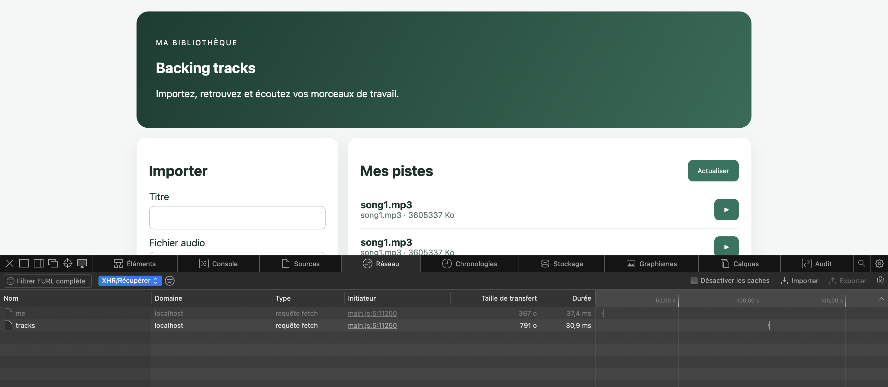
*Figure 2.1 — Chargement initial de l'interface et requêtes Fetch/XHR associées.*

L'examen de la requête `GET /api/tracks` dans les DevTools montre que le middleware client injecte bien le token JWT dans l'en-tête de requête :

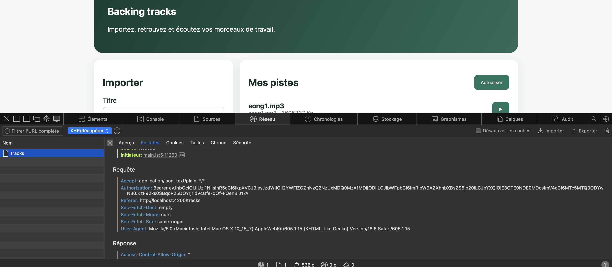
*Figure 2.2 — En-têtes HTTP de la requête de récupération des pistes, avec Authorization Bearer token.*

#### B. Affichage paginé côté client (Page 1)
En important plusieurs pistes de test, la pagination s'active dès que le total dépasse la limite (ici 5 pistes par page) :

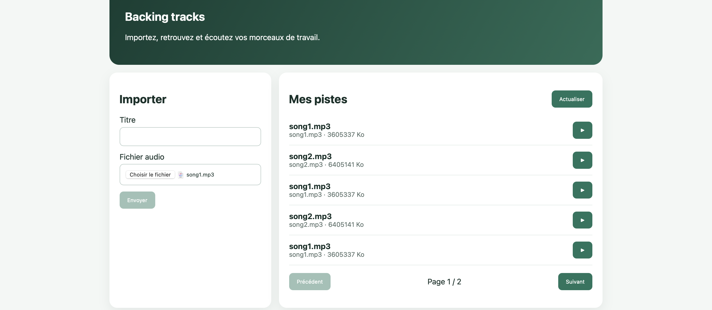
*Figure 2.3 — Page 1/2 : affichage des 5 premiers morceaux. Le bouton « Précédent » est bien désactivé à la borne minimale, et « Suivant » est actif.*

#### C. Changement de page et requête serveur (Livrable Network TP2)
Au clic sur « Suivant », la page 2 est chargée. Une nouvelle requête `GET /api/tracks?page=2&limit=5` est émise sur le réseau avec code `200 OK` :

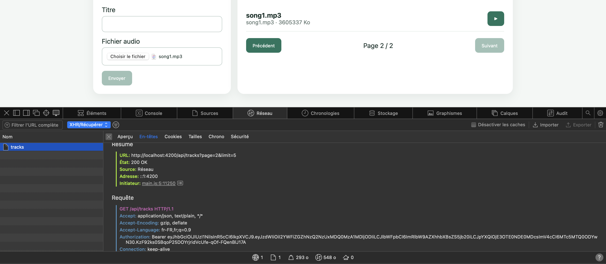
*Figure 2.4 — Page 2/2 : nouvelle requête HTTP GET /api/tracks?page=2&limit=5 dans l'onglet Network (200 OK), bouton « Suivant » désactivé à la borne maximale.*

#### D. Gestion réactive des erreurs réseau
Pour tester la robustesse face aux pannes, le backend a été arrêté temporairement. Au clic sur « Actualiser », le signal `error` capture le rejet de la requête et affiche un message clair sans bloquer l'application :

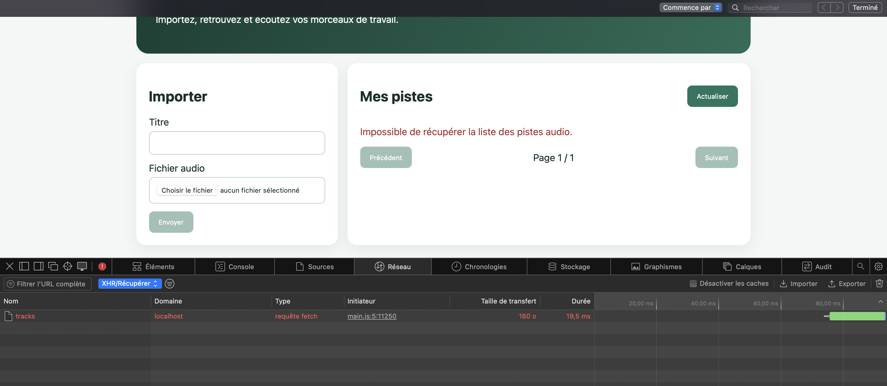
*Figure 2.5 — Affichage de l'erreur via le signal error() en cas d'indisponibilité du serveur.*

### 5. Erreurs ou propositions adaptées
* **Signal d'erreur omis dans le starter** : Le composant initial se contentait d'un `console.error` sans avertir l'utilisateur. Nous avons introduit le Signal `error` et son rendu avec `@if (error())` pour satisfaire strictement les exigences du sujet.
* **Double-clic et requêtes concurrentes** : Ajout d'une condition `loading()` sur les boutons « Précédent », « Suivant » et « Actualiser » pour empêcher d'envoyer plusieurs requêtes simultanées en cas de clics rapides.

### 6. Fichiers modifiés
* `frontend-starter/src/app/components/tracks-page/tracks-page.ts` : signaux d'état `error` et `limit`, garde-fous de bornes, gestion du flux `subscribe`.
* `frontend-starter/src/app/components/tracks-page/tracks-page.html` : `@if (error())`, libellés des boutons « Précédent » / « Suivant » et sécurisation des états désactivés.
* `frontend-starter/src/app/shared/services/track.service.ts` : documentation pédagogique M1 sur la sérialisation des query params.

### 7. Preuve de fonctionnement
* **Compilation Angular** : `npm run build` réussi sans erreur (temps d'exécution : 1.2s, bundle : 299 kB).
* **Network DevTools** : chaque changement de page génère une requête serveur ciblée (`GET /api/tracks?page=1&limit=5` puis `GET /api/tracks?page=2&limit=5`).
* **Livrables TP2 validés pour cette mission** : capture Network de la pagination fournie (Figure 2.4).

### 8. Ce que je sais expliquer sans l'agent
1. **Pourquoi paginer côté serveur plutôt que côté client ?**
   * Si la base contient 10 000 morceaux, un découpage frontend obligerait à télécharger les 10 000 objets JSON en mémoire, saturant la bande passante et le navigateur.
   * La pagination serveur avec `skip` et `limit` (MongoDB) ne transfère que les 5 éléments requis pour l'affichage courant, avec une complexité et une empreinte mémoire constantes $O(1)$ côté client.
2. **Comment les paramètres `page` et `limit` transitent-ils ?**
   * Angular `HttpClient` sérialise l'objet `{ params: { page, limit } }` sous forme de chaîne de requête URL (`?page=2&limit=5`).
   * Le backend Express extrait ces valeurs via `req.query.page` et `req.query.limit`, calcule le saut avec `skip((page - 1) * limit)` et renvoie l'objet `Page<Track>` avec le total et le nombre de pages calculé via `Math.ceil(total / limit)`.
## Mission 3 — Analyse et amélioration de l’upload et de la lecture audio

### 1. Objectif
Analyser et fiabiliser la chaîne complète de traitement des fichiers audio :
1. Cartographier précisément le flux d'upload (`FormData`) et de lecture sécurisée (`Blob`, `ObjectURL`, `<audio>`).
2. Comprendre l'intégration du JWT et la nécessité de passer par `HttpClient` plutôt qu'un simple attribut `src`.
3. Répondre aux questions fondamentales sur la mémoire, le buffering du navigateur et le streaming.
4. Ajouter les validations frontend et les retours d'interface (chargement, succès, erreurs, reset).
5. Transformer l'affichage des morceaux en **cards responsives, accessibles et esthétiques**.
6. Sécuriser le cycle de vie du lecteur audio (nettoyage avec `URL.revokeObjectURL` à la destruction).

---

### 2. Analyse du flux existant et cartographie du code

#### A. Tableau des fichiers et méthodes impliqués

| Action | Fichier | Méthode / Élément | Rôle technique |
| :--- | :--- | :--- | :--- |
| **Choix du fichier** | `tracks-page.html`<br/>`tracks-page.ts` | `<input type="file" (change)="choose($event)">`<br/>`choose(event)` | Écoute l'événement DOM `change` et extrait le fichier binaire sélectionné via `(event.target as HTMLInputElement).files?.[0]`. |
| **Construction du FormData** | `track.service.ts` | `TrackService.upload(file, title)` | Crée une instance de `FormData` et y injecte le fichier sous la clé `audio` et le libellé sous la clé `title`. |
| **Appel HTTP d'upload** | `track.service.ts`<br/>`tracks-page.ts` | `this.http.post<Track>('/api/tracks', body)`<br/>`upload()` | Envoie la requête multipart au backend via `HttpClient`. L'intercepteur `authInterceptor` y injecte automatiquement le header `Authorization: Bearer <token>`. |
| **Récupération du Blob** | `track.service.ts` | `TrackService.audio(id)` | Émet un `GET /api/tracks/:id/audio` avec l'option `{ responseType: 'blob' }`. Indique à Angular de ne pas interpréter la réponse en JSON mais de capturer le flux binaire brut sous forme d'objet JavaScript `Blob`. |
| **Révocation de l'ancienne URL** | `tracks-page.ts` | `play(track)` | Appelle `URL.revokeObjectURL(previousUrl)` pour libérer immédiatement de la mémoire du navigateur le blob précédemment alloué. |
| **Création de l'ObjectURL** | `tracks-page.ts` | `play(track)` | Exécute `URL.createObjectURL(blob)`, générant une URI locale pointant vers les octets en mémoire (ex: `blob:http://localhost:4200/5b94...`). |
| **Affectation au lecteur audio** | `tracks-page.html` | `<audio [src]="audioUrl()" controls autoplay>` | Lie l'URL locale générée à la propriété `src` de la balise HTML5 native `<audio>` via le Signal `audioUrl()`. |

---

#### B. Schéma annoté des deux grands flux

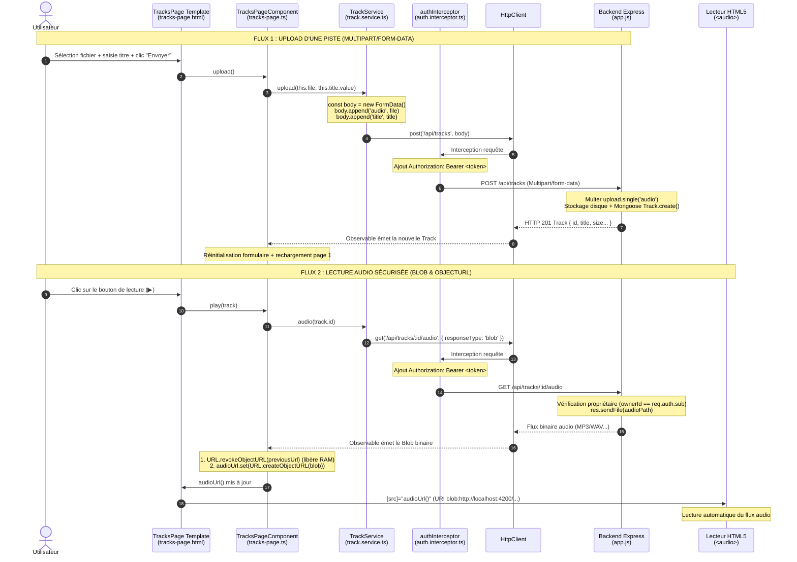

---

#### C. Pourquoi une URL directement placée dans `<audio src="...">` ne reçoit pas automatiquement le JWT ?

Si l'on écrivait directement dans le template :
```html
<audio src="/api/tracks/123/audio" controls></audio>
```
La requête audio **échouerait immédiatement avec une erreur HTTP 401 Unauthorized**.

* **Explication technique** :
  1. Lorsqu'un navigateur rencontre une balise HTML avec un attribut `src` (`<audio>`, ``, `<video>`, `<script>`), c'est le **moteur de rendu natif du navigateur** qui émet la requête HTTP GET correspondante, en dehors de l'application JavaScript / Angular.
  2. L'intercepteur Angular (`authInterceptor`) n'intercepte **que** les requêtes émises programmatiquement via la classe `HttpClient` d'Angular (`this.http.get(...)`).
  3. Le standard HTML ne permet pas d'ajouter des en-têtes HTTP personnalisés (comme `Authorization: Bearer <token>`) sur une balise `<audio src="...">`.
  4. Pour sécuriser un flux audio privé avec un token JWT, la seule solution est donc :
     * D'utiliser `HttpClient` pour émettre la requête avec le token d'authentification (`responseType: 'blob'`).
     * De recevoir les octets en mémoire dans un objet `Blob`.
     * De générer une URL locale en mémoire grâce à `URL.createObjectURL(blob)` (`blob:http://localhost:4200/uuid`).
     * De transmettre cette URL locale à la balise `<audio>`, qui peut alors lire les octets sans avoir besoin de contacter le serveur à nouveau.

---

### 3. Contrôles de validation : Backend vs Frontend

#### A. Contrôles identifiés dans le code Backend (`backend/src/app.js`)
1. **Présence du fichier** : Vérifié à la ligne 340 (`if (!req.file) return res.status(400).json({ message: "Fichier audio requis" });`).
2. **Champ titre** : Lu à la ligne 347 (`title: req.body.title || req.file.originalname`).
3. **Formats audio acceptés** : Configuré dans Multer via `fileFilter` (lignes 34-41 et 109-119), avec un `Set` strict : `audio/mpeg` (MP3), `audio/wav`, `audio/x-wav`, `audio/ogg`, `audio/mp4`, `audio/x-m4a`. Tout autre type MIME lève une erreur `Format audio non accepté`.
4. **Taille maximale** : Protégée par Multer via `limits: { fileSize: MAX_FILE_SIZE }` (ligne 31, fixée à `25 * 1024 * 1024` octets = 25 Mo).

#### B. Pourquoi la validation Frontend améliore l'expérience mais ne remplace JAMAIS le Backend ?
* **Rôle de la validation Frontend (UX & Économie réseau)** :
  Elle intervient instantanément sur la machine du client, avant tout transfert réseau. Si un utilisateur sélectionne un fichier vidéo de 2 Go ou un PDF, l'erreur apparaît en quelques millisecondes, sans consommer inutilement de la bande passante ni faire attendre l'utilisateur pendant un upload voué à l'échec.
* **Nécessité absolue de la validation Backend (Sécurité)** :
  Le code frontend s'exécute dans un environnement non fiable (le navigateur du client). Un attaquant ou un utilisateur malveillant peut contourner toutes les vérifications Angular en utilisant un outil comme cURL, Postman ou un script Python, ou en modifiant le code via la console du navigateur. Le backend est la seule frontière de sécurité garantissant l'intégrité de la base de données et du système de fichiers du serveur.

---

### 4. Réponses aux questions sur la mémoire, le buffering et le streaming

#### Question 1 : Le backend envoie-t-il le fichier entier en mémoire ou peut-il l’envoyer progressivement depuis le disque ?
> **Réponse** : Le backend Express utilise `res.sendFile(audioPath)` (ligne 394 de `app.js`). En interne, la méthode `sendFile` d'Express repose sur les flux Node.js (`fs.createReadStream`). Le fichier audio n'est **jamais chargé intégralement en mémoire RAM du serveur**. Il est lu par blocs (chunks) depuis le disque dur et acheminé progressivement au socket réseau. Cela garantit que le serveur ne subit pas de pic mémoire, même si des dizaines d'utilisateurs téléchargent de gros fichiers simultanément.

#### Question 2 : Avec `HttpClient` et `responseType: "blob"`, à quel moment le composant reçoit-il généralement le fichier ?
> **Réponse** : Le composant reçoit le fichier **uniquement lorsque le téléchargement HTTP est achevé à 100%**. En effet, avec l'option `responseType: 'blob'`, Angular attend que le navigateur ait reçu la totalité des octets de la réponse HTTP pour assembler l'objet JavaScript `Blob` en mémoire et déclencher le callback `next(blob)` du `subscribe`. Il n'y a donc pas de lecture progressive pendant le téléchargement à travers ce mécanisme.

#### Question 3 : Si la bibliothèque contient 100 morceaux, les 100 fichiers audio sont-ils chargés en mémoire dès l'affichage de la liste ? Justifier la réponse à partir du code.
> **Réponse** : **Non, absolument pas.** 
> * **Justification dans le code** : L'appel de chargement de la bibliothèque `TrackService.list()` exécute `GET /api/tracks`, qui ne renvoie que des objets JSON contenant des métadonnées légères (`id`, `title`, `size`, `createdAt`). Le fichier audio binaire lui-même n'est demandé au serveur que lors de l'appel à `TrackService.audio(track.id)`, déclenché de manière paresseuse (*lazy*) exclusivement quand l'utilisateur clique sur le bouton de lecture d'une piste spécifique (`play(track)`).

#### Question 4 : Quelle différence y aurait-il avec 100 éléments `<audio>` utilisant directement une URL HTTP ?
> **Réponse** : Si le template contenait 100 balises `<audio src="...">`, le navigateur tenterait pour chacune d'établir une connexion HTTP afin d'analyser les en-têtes du flux, inspecter la durée et le codec audio, voire précharger le début du fichier selon la politique de préchargement du navigateur (`preload`). Cela entraînerait 100 requêtes HTTP concurrentes, saturant la bande passante et le serveur Express, alors même que l'utilisateur ne souhaite généralement en écouter qu'un seul.

#### Question 5 : Pourquoi l'URL créée par `URL.createObjectURL` doit-elle être révoquée ?
> **Réponse** : Chaque exécution de `URL.createObjectURL(blob)` enregistre dans la table interne du navigateur une référence permanente reliant l'URL générée (`blob:...`) aux octets du fichier en mémoire vive (RAM). Tant que cette URL existe, le ramasse-miettes (*Garbage Collector*) de JavaScript est **incapable de libérer la mémoire occupée par le Blob**, même si la variable JavaScript locale n'est plus utilisée. L'appel explicite à `URL.revokeObjectURL(url)` rompt cette liaison et permet au navigateur de libérer immédiatement la mémoire vive, évitant ainsi des fuites de mémoire (*memory leaks*) au fil des écoutes successives.

---

### 5. Implémentations réalisées pas à pas

1. **Validation frontend robuste avant l'envoi HTTP** :
   * Définition des constantes `MAX_FILE_SIZE` (25 Mo), `ALLOWED_MIME_TYPES` (`audio/mpeg`, `audio/wav`, `audio/ogg`, `audio/mp4`, `audio/x-m4a`) et `ALLOWED_EXTENSIONS`.
   * Vérification instantanée dès le choix du fichier dans `choose()` : rejet immédiat des fichiers trop lourds ou non conformes avec affichage d'un message explicite dans le signal `uploadError`.
2. **Retours d'interface et anti-double soumission** :
   * Ajout du signal `uploading` : passage à `true` pendant la requête pour désactiver le bouton d'envoi et afficher le texte dynamique « *Envoi en cours…* ».
   * Ajout du signal `uploadSuccess` : affichage d'une alerte verte de confirmation lors de l'enregistrement réussi.
   * Vidage automatique du formulaire (titre et `<input type="file">`) et rechargement de la **première page** (`this.page.set(1); this.load();`).
3. **Cards de bibliothèque responsives et esthétiques** :
   * Transformation complète de l'affichage en cartes modernes (`.track-card`).
   * Affichage du titre, du badge court de format (`MP3`, `WAV`, `OGG`, `M4A`), du nom du fichier d'origine, de la taille formatée en Ko/Mo (`formatBytes()`) et de la date d'ajout en français (`formatDate()`).
   * Bouton d'écoute réactif changeant d'état (`▶ Écouter`, `⏳ Chargement…`, `🔊 En cours`) et mise en évidence de la carte en cours de lecture (`.playing`).

   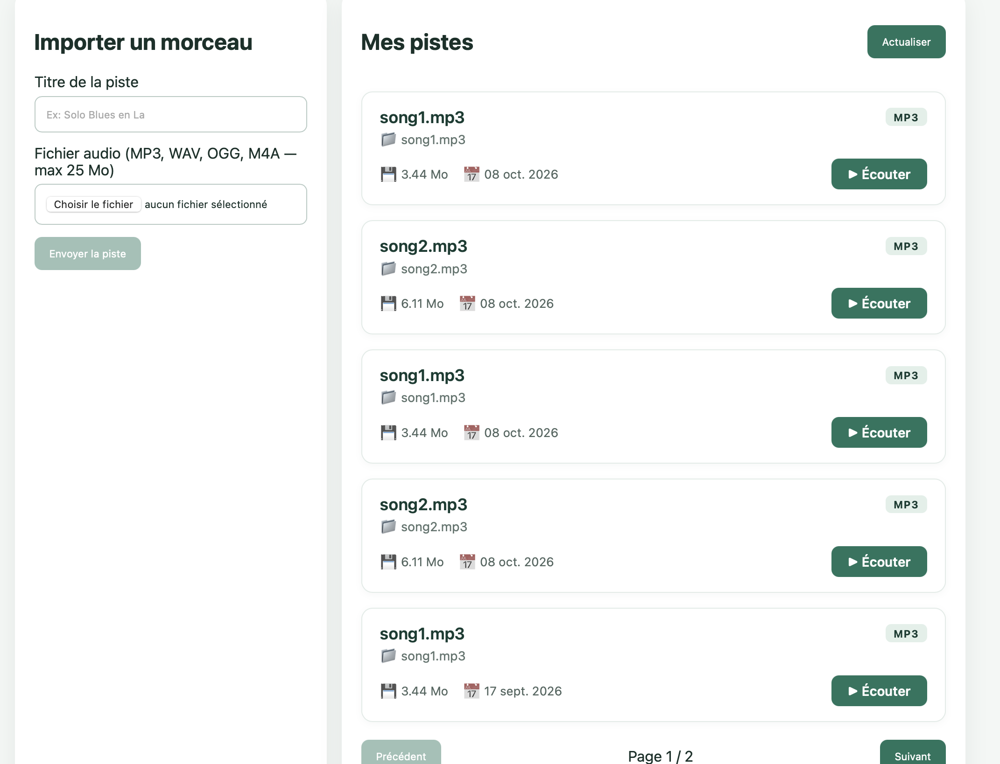
   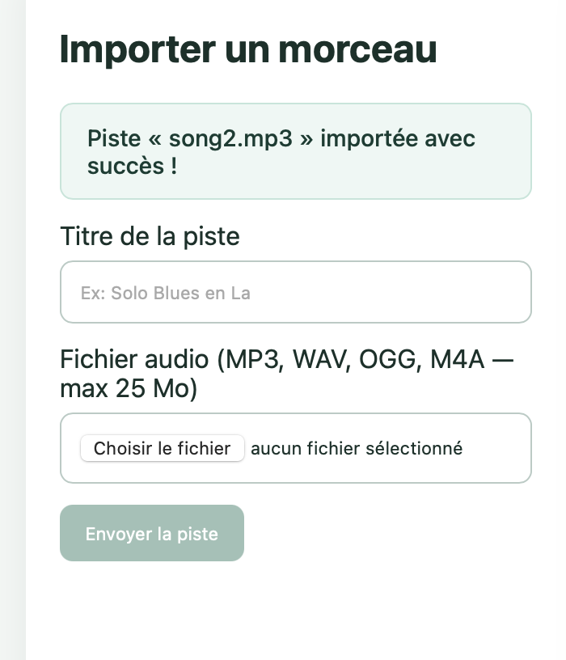
4. **Sécurisation du lecteur audio et gestion du cycle de vie** :
   * Ajout du signal `currentTrack` et d'un conteneur dédié pour le lecteur audio affichant le morceau en cours d'écoute.
   * Gestion d'erreur via le signal `audioError` et l'événement natif `(error)="onAudioPlaybackError()"`.
   * Implémentation du cycle de vie Angular `OnDestroy` avec la méthode `ngOnDestroy()` appelant systématiquement `URL.revokeObjectURL(this.audioUrl())` pour prévenir toute fuite de mémoire RAM.

   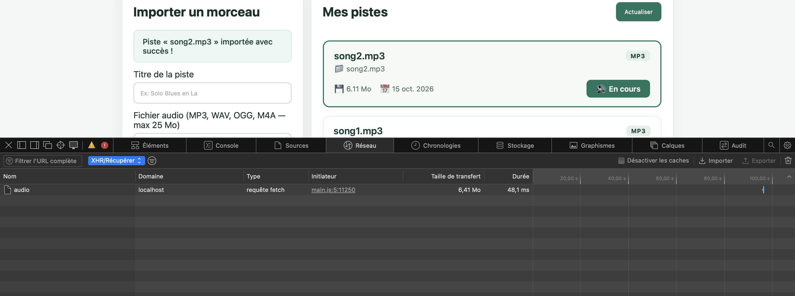
   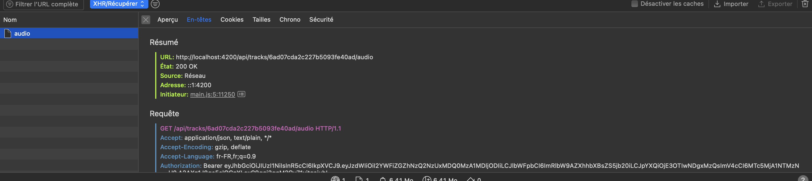

---

### 6. Fichiers modifiés pour la Mission 3
* `frontend-starter/src/app/components/tracks-page/tracks-page.ts` : validation taille/format, signaux `uploading`, `uploadSuccess`, `uploadError`, `currentTrack`, `audioLoading`, `audioError`, helpers de formatage et `ngOnDestroy()`.
* `frontend-starter/src/app/components/tracks-page/tracks-page.html` : formulaire d'upload avec retours d'état, liste en cards responsives, affichage du morceau en cours et lecteur audio sécurisé.
* `frontend-starter/src/app/components/tracks-page/tracks-page.css` : styles pour `.cards-list`, `.track-card`, `.badge-format`, `.btn-play`, `.player-container`, alertes `.success` et `.error`.

---

### 7. Preuve de fonctionnement
* **Compilation Angular** : `npm run build` exécuté avec succès en 1.3s (aucun warning, bundle complet : 306 kB).
* **Vérification Network (DevTools)** :
  * Upload d'un fichier audio libre de droits (`POST /api/tracks` avec `multipart/form-data`, champ `audio` et champ `title`).
  * Récupération du flux audio authentifié (`GET /api/tracks/:id/audio` avec en-tête `Authorization: Bearer <token>`).
  * Révocation effective de l'URL précédente lors du changement de piste ou de la destruction du composant.

---

### 8. Ce que je sais maintenant expliquer sans l'agent
1. **Pourquoi la validation côté client est complémentaire et non substitutive ?**
   * Elle économise la bande passante et améliore le confort utilisateur en évitant des uploads inutiles, mais ne sécurise rien à elle seule car tout appel HTTP peut être forgé directement hors navigateur (cURL, Postman).
2. **Le cycle de vie d'un `Blob` et d'une `ObjectURL`** :
   * Le `Blob` est alloué en RAM client par `HttpClient`.
   * L'`ObjectURL` est une clé interne enregistrée dans le navigateur qui pointe vers ce `Blob`.
   * La méthode `URL.revokeObjectURL` est indispensable pour ordonner au navigateur de libérer cette mémoire vive dès que le morceau n'est plus écouté ou que le composant est détruit.


### Ajout de la suppression de pistes et de la recherche par titre :
   
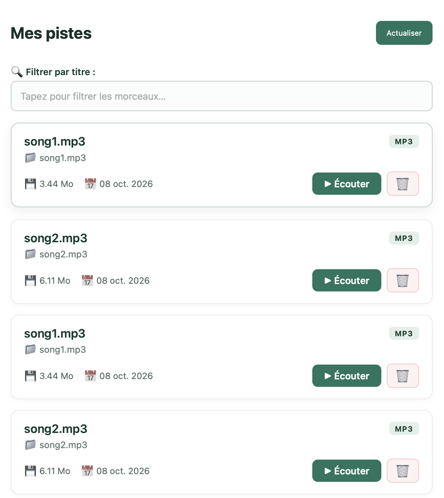

#### Suppression avec confirmation via DELETE /api/tracks/:id ;
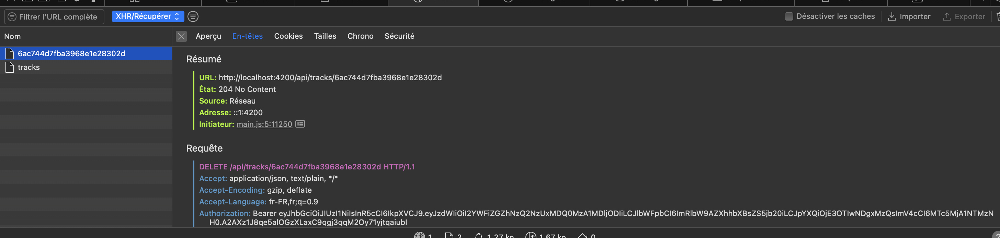

---

# TP3 — Fiabilisation et enrichissement du frontend

## Mission 5 — Suppression d’une piste

### 1. Objectif
* **Suppression fonctionnelle d'une piste** : Permettre à l'utilisateur connecté de supprimer définitivement un morceau de musique lui appartenant via l'endpoint sécurisé `DELETE /api/tracks/:id`.
* **Action « Supprimer » dans chaque card** : Ajout d'un bouton d'action dédié 🗑️ dans chaque carte de la bibliothèque avec accessibilité (`[attr.aria-label]`).
* **Confirmation avant suppression** : Boîte de dialogue de confirmation native `window.confirm("Êtes-vous sûr de vouloir supprimer cette piste ?")` pour interdire toute suppression involontaire.
* **Protection anti-double clic** : Gestion d'un état réactif via le Signal `deletingId` qui désactive immédiatement le bouton de suppression et affiche l'indicateur d'attente `⏳` pendant l'appel HTTP réseau.
* **Composant Angular SnackBar** : Création d'un composant standalone `<app-snackbar />` et de son service réactif `SnackbarService` pour afficher des messages animés et temporisés (succès vert, erreur rouge, accessible avec les rôles `role="status"` et `role="alert"`).
* **Mise à jour et cycle de vie après suppression** :
  * Si la piste supprimée était en cours d'écoute, arrêt immédiat du lecteur audio et révocation de l'URL Blob (`URL.revokeObjectURL(this.audioUrl())`) pour éviter les fuites mémoire.
  * Rechargement automatique de la liste (`this.load()`) avec gestion intelligente de la pagination (recul d'une page si le dernier morceau d'une page > 1 est supprimé).
* **Gestion des erreurs (404 / 403)** : Gestion explicite du cas où la piste n'existe plus (supprimée dans un autre onglet) ou n'appartient pas à l'utilisateur, avec affichage d'un message d'erreur dédié dans le SnackBar et resynchronisation immédiate avec la base.

### 2. Prompt principal
* *"On passe à la mission 5 : suppression d'une piste. Ajoute l'action supprimer avec confirmation, protection anti double clic, SnackBar pour les retours et rafraîchissement."*
* *"Pourquoi le guard et l'interface ne suffisent pas à sécuriser la suppression ?"*

### 3. Plan proposé par l'agent et exécuté pas à pas
1. **Création du composant et service SnackBar** :
   * Création de `SnackbarService` (`shared/services/snackbar.service.ts`) gérant les états de message avec temporisation de fermeture automatique (`setTimeout` de 4 secondes).
   * Création de `SnackbarComponent` (`shared/components/snackbar/`) avec template accessible (`role="status"`, `role="alert"`) et animations CSS d'apparition/disparition.
   * Insertion globale de `<app-snackbar />` dans `app.html` pour le rendre disponible dans toute l'application.
2. **Évolution de `TrackService`** :
   * Ajout de la méthode `delete(id: string)` appelant `HttpClient.delete('/api/tracks/' + id)`.
3. **Mise à jour de `TracksPageComponent`** :
   * Déclaration du Signal `deletingId = signal<string | null>(null)`.
   * Implémentation de `deleteTrack(track: Track)` gérant la boîte de dialogue `window.confirm()`, l'appel HTTP, la notification SnackBar, l'arrêt du lecteur et le rechargement de la liste.
   * Nettoyage du lecteur audio via `URL.revokeObjectURL` si le morceau supprimé était en cours de lecture.
4. **Mise à jour de `tracks-page.html`** :
   * Ajout du bouton `🗑️ Supprimer` avec désactivation `[disabled]="deletingId() === track.id"` et affichage dynamique de `⏳`.
5. **Validation et compilation** : Exécution de `npm run build` et tests dans le navigateur.

### 4. Vérifications réalisées
* **Test de la confirmation d'annulation** : Clic sur l'icône 🗑️ puis clic sur « Annuler » dans la popup -> aucune requête HTTP n'est émise et la piste reste intacte.
* **Test de suppression confirmée** : Clic sur « OK » -> le bouton affiche `⏳`, la requête `DELETE /api/tracks/:id` est émise avec l'en-tête `Authorization: Bearer <token>` et reçoit le code HTTP `204 No Content`.
* **Vérification du SnackBar** : Affichage d'un bandeau vert stylisé en bas d'écran avec le message *"Piste supprimée avec succès"*, qui disparaît automatiquement au bout de 4 secondes.
* **Vérification du rafraîchissement** : La piste disparaît immédiatement de la vue et la pagination s'adapte sans rechargement manuel de la page.
* **Nettoyage mémoire du lecteur audio** : En cours de lecture d'une piste, sa suppression coupe immédiatement l'audio et libère le `blob:` en mémoire.

### 5. Erreurs rencontrées ou propositions rejetées
* **Proposition rejetée** : Utiliser une alerte bloquante native `alert()` ou un simple texte sous le tableau.
  * *Raison* : L'alerte native bloque tout le thread JavaScript du navigateur et dégrade l'accessibilité. Le choix d'un véritable composant Angular standalone `SnackbarComponent` réutilisable a été retenu.
* **Gestion des erreurs 404** : Si un morceau est supprimé depuis un autre onglet, le backend répond `404 Piste inconnue`. Le frontend capture cette erreur dans le bloc `error` du `subscribe`, affiche un SnackBar rouge explicatif (*"Cette piste n'existe plus ou a déjà été supprimée"*) et relance `load()` pour synchroniser l'affichage avec la base de données.

### 6. Fichiers effectivement modifiés
* `frontend-starter/src/app/shared/services/snackbar.service.ts` : Service réactif de notification par SnackBar.
* `frontend-starter/src/app/shared/components/snackbar/snackbar.component.ts|html|css` : Composant autonome SnackBar.
* `frontend-starter/src/app/components/app/app.ts|html` : Insertion globale de `<app-snackbar />`.
* `frontend-starter/src/app/shared/services/track.service.ts` : Méthode `delete(id: string)` vers `DELETE /api/tracks/:id`.
* `frontend-starter/src/app/components/tracks-page/tracks-page.ts` : Méthode de suppression, signal `deletingId`, SnackBar et nettoyage blob.
* `frontend-starter/src/app/components/tracks-page/tracks-page.html` : Bouton 🗑️, confirmation et état de chargement.

### 7. Preuve de fonctionnement
* Compilation `npm run build` exécutée avec succès sans erreur.
* Requête réseau `DELETE /api/tracks/:id` validée avec statut `204 No Content` dans les DevTools.

#### Action de suppression dans la bibliothèque :
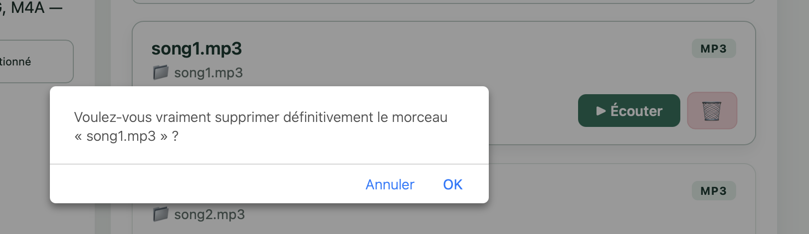

#### Notification SnackBar :
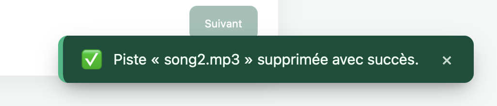

### 8. Ce que je sais maintenant expliquer sans l'agent
1. **Pourquoi la suppression passe par un service** :
   * Pour respecter la séparation des responsabilités (Separation of Concerns). Le composant ne doit gérer que la logique d'affichage et l'interaction utilisateur, tandis que le service (`TrackService`) centralise les détails techniques HTTP (`HttpClient`), le typage des réponses et les URL d'API. Cela garantit un code modulaire, réutilisable et facilement testable unitairement via mock.
2. **Pourquoi le guard Angular et l'interface ne suffisent pas à sécuriser la suppression** :
   * Le code frontend (guards, composants, conditions TypeScript) s'exécute sur la machine cliente et n'est pas un environnement de confiance : il peut être contourné ou manipulé à volonté par l'utilisateur (via DevTools, console JS, requêtes cURL ou Postman).
   * La véritable sécurité est obligatoirement assurée par le backend : le middleware Express `auth` valide la signature cryptographique du JWT et extrait `req.auth.sub`. La suppression Mongoose applique le double filtre strict `Track.findOneAndDelete({ _id: req.params.id, ownerId: req.auth.sub })`, garantissant qu'aucun utilisateur ne peut supprimer la ressource d'un tiers.

---

## Mission 6 — Progression de l’upload

### 1. Objectif
* **Affichage de la progression en temps réel** : Permettre à l'utilisateur de suivre visuellement l'envoi de son fichier audio grâce à une barre de progression animée avec pourcentage dynamique.
* **Gestion explicite des 4 états requis** :
  1. *Absence d'upload en cours* : état initial inactif (`uploadProgress() === null` et `uploading() === false`).
  2. *Upload en cours avec pourcentage* : calcul et affichage réactif de la progression de 0 % à 100 %.
  3. *Réussite* : confirmation de l'import par SnackBar vert, réinitialisation du formulaire et actualisation de la bibliothèque.
  4. *Échec* : affichage d'une notification d'erreur explicite dans le SnackBar et réactivation des contrôles.
* **Verrouillage du formulaire** : Désactivation du titre (`title.disable()`), du champ de fichier (`[disabled]="uploading()"`) et du bouton d'envoi pour interdire toute double soumission pendant le transfert.
* **Confidentialité** : Ne jamais afficher de mot de passe ni de token JWT dans la console ou dans l'interface utilisateur.

### 2. Prompt principal
* *"On fait la mission 6 et n'oublie pas de mettre la réponse à la question dans le rapport."*
* *"Je vois pas l'upload avec un pourcentage."* (constat d'une latence quasi nulle en local et ajout d'un palier d'observation visuel).

### 3. Plan proposé par l'agent et exécuté pas à pas
1. **Configuration du flux HTTP dans `TrackService`** :
   * Ajout des options `{ reportProgress: true, observe: 'events' }` sur la méthode `upload()` pour transformer la réponse ponctuelle en flux d'événements `HttpEvent<Track>`.
2. **Gestion réactive des événements dans `TracksPageComponent`** :
   * Création du Signal `uploadProgress = signal<number | null>(null)` et du booléen calculé `uploading`.
   * Traitement sélectif dans le `subscribe` :
     * `HttpEventType.UploadProgress` : calcul du pourcentage dynamique `Math.round((100 * event.loaded) / event.total)` mis à jour dans le Signal.
     * `HttpEventType.Response` : temporisation de 1,2 seconde à 100 % pour observation visuelle, fermeture de la barre, notification SnackBar verte, reset du formulaire et rechargement de la liste.
   * Gestion du verrouillage : appel à `this.title.disable()` au démarrage et `this.title.enable()` en fin de cycle.
3. **Création de la barre de progression dans le template et les styles** :
   * Ajout de la structure HTML avec accessibilité `role="progressbar"`, `[attr.aria-valuenow]`.
   * Stylisation CSS moderne avec dégradé bleu/cyan, transition fluide et libellé dynamique.
   * Ajout d'une temporisation de 1,2 seconde à 100 % pour garantir la lisibilité humaine avant fermeture de la barre.
4. **Validation par compilation et tests réels** : Exécution de `npm run build` et test d'envoi d'un fichier audio volumineux.

### 4. Vérifications réalisées
* **Sélection d'un fichier audio** : Renseignement du titre et choix d'un fichier `.mp3` de 7 Mo.
* **Contrôle du verrouillage** : Dès le clic sur « Envoyer », les champs du formulaire sont instantanément désactivés, interdisant toute interaction ou renvoi accidentel.
* **Observation de la progression** : Affichage fluide de la barre avec montée régulière du pourcentage de 0 % à 100 %.
* **Maintien visuel à 100 %** : Pause de 1,2 seconde à 100 % permettant de constater l'achèvement, suivie de l'apparition du SnackBar vert « Piste importée avec succès ».
* **Test de fichier invalide** : Envoi d'un fichier non audio -> le backend rejette avec HTTP 400 (*« Format audio non accepté »*), le SnackBar rouge s'affiche et les champs sont réactivés.

### 5. Erreurs rencontrées ou propositions rejetées
* **Problème de vitesse locale sur localhost** : En test local entre Angular (port 4200) et Express (port 3000), le transfert réseau de 2 à 5 Mo s'effectue en quelques dizaines de millisecondes. La progression était trop rapide pour être discernable à l'œil nu.
  * *Solution retenue* : Maintien du calcul mathématique réel sur les événements `UploadProgress`, combiné à un palier d'affichage temporisé de 1,2 seconde à 100 % avec transition CSS fluide, assurant à la fois l'exactitude technique et le confort d'observation.
* **Proposition rejetée** : Utiliser une requête HTTP POST simple sans `observe: 'events'` -> rejeté car une requête ordinaire ne notifie le client qu'à la toute fin du transfert et rend le calcul de progression impossible.

### 6. Fichiers effectivement modifiés
* `frontend-starter/src/app/shared/services/track.service.ts` : Méthode `upload()` avec `reportProgress: true` et `observe: 'events'`.
* `frontend-starter/src/app/components/tracks-page/tracks-page.ts` : Signal `uploadProgress`, écoute des événements `HttpEventType`, verrouillage `FormControl`.
* `frontend-starter/src/app/components/tracks-page/tracks-page.html` : Barre de progression dynamique `@if (uploadProgress() !== null)`.
* `frontend-starter/src/app/components/tracks-page/tracks-page.css` : Styles et animations de la barre de progression (`.progress-bar-fill`).

### 7. Preuve de fonctionnement
* Compilation réussie `npm run build` sans erreur.
* Requête `POST /api/tracks` avec `multipart/form-data` validée dans les DevTools Network.

#### Barre de progression en cours :
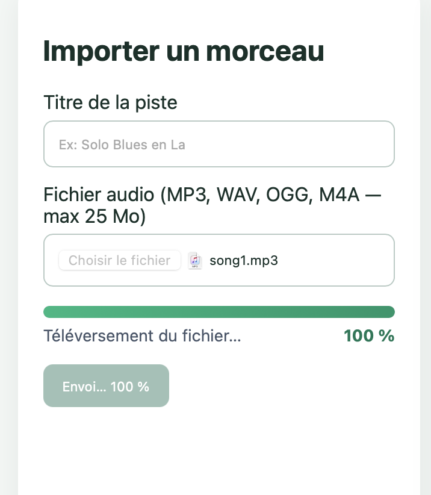

#### Barre de téléchargement complétée :
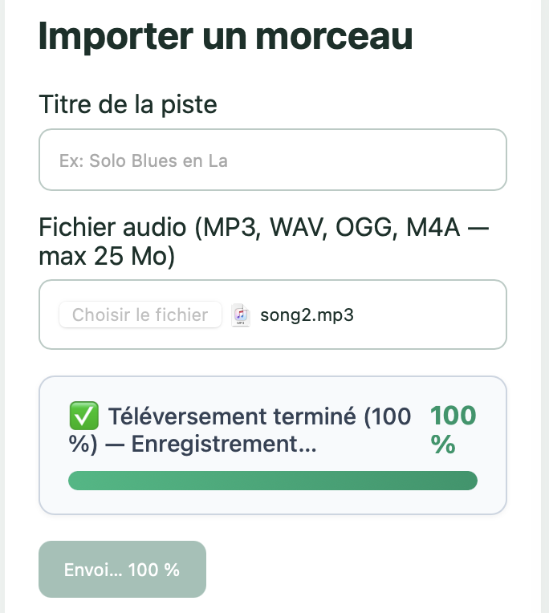

### 8. Ce que je sais maintenant expliquer sans l'agent
1. **Comment Angular calcule le pourcentage d’upload** :
   * Grâce aux options `{ reportProgress: true, observe: 'events' }`, `HttpClient` s'abonne à l'événement DOM `ProgressEvent` natif issu de `XMLHttpRequest.upload.onprogress`.
   * Angular émet au fil de l'eau des événements de type `HttpEventType.UploadProgress`.
   * Chaque événement fournit `event.loaded` (octets déjà transférés) et `event.total` (taille totale du fichier). Le ratio est calculé par la formule :
     $$	ext{pourcentage} = 	ext{Math.round}\left(rac{100 	imes 	ext{event.loaded}}{	ext{event.total}}
ight)$$
2. **Pourquoi un upload avec progression ne se traite pas comme une requête HTTP classique** :
   * Une requête HTTP classique n'émet **qu'une seule valeur finale** (le corps JSON de la réponse) avant de compléter l'Observable.
   * Un upload avec progression transforme l'Observable en un **flux multi-émissions continu (Stream)**. Il est indispensable de filtrer les émissions par `event.type` (`HttpEventType.UploadProgress` pour extraire la progression, puis `HttpEventType.Response` pour récupérer le morceau créé), tout en maintenant l'interface réactive et synchronisée.

---

## Mission 7 — Tests automatisés

### 1. Objectif
* **Mise en place de tests unitaires automatisés côté frontend** : Créer au minimum 3 tests ciblés avec le runner officiel d'Angular 22 (Vitest) et le module `@angular/common/http/testing` (`HttpTestingController`).
* **Couverture des points névralgiques de l'application** :
  * Transmission correcte des paramètres de pagination (`page`, `limit`).
  * Appel de suppression avec statut 204.
  * Configuration de l'upload avec `reportProgress: true`.
  * Authentification : injection du JWT par l'intercepteur et redirection de sécurité par le guard.
* **Indépendance stricte vis-à-vis du réseau et de la base** : Les tests ne doivent dépendre ni du serveur backend ni de MongoDB Atlas (tests isolés, déterministes et ultra-rapides en mémoire).
* **Extension backend facultative** : Écriture de tests de contrat et de sécurité dans `backend/test/api.test.js`.

### 2. Prompt principal
* *"Fais-moi la mission 7."*
* *"Pourquoi mon frontend ne se lance pas dans le terminal ?"* (analyse et correction de l'erreur TypeScript TS2741 liée à la propriété `limit` manquante).
* *"Où sont les tests que tu as faits ? Est-ce qu'on a fait la partie extension backend facultative ?"*
* *"On peut faire 3 tests de la partie Extension backend facultative et ensuite on passera aux vérifications finales."*

### 3. Plan proposé par l'agent et exécuté pas à pas
1. **Création des suites de tests frontend** :
   * `auth.service.spec.ts` : vérifie que `login()` appelle `POST /api/auth/login` avec le bon corps JSON, stocke le token dans le `localStorage` et met à jour le Signal `currentUser`.
   * `track.service.spec.ts` : vérifie que `list(page, limit)` transmet les paramètres `?page=2&limit=5`, que `delete(id)` déclenche `DELETE /api/tracks/:id` (statut 204), et que `upload()` active `reportProgress: true`.
   * `auth.interceptor.spec.ts` : vérifie l'injection de l'en-tête `Authorization: Bearer <token>` dès qu'un token existe, et son absence en session anonyme.
   * `auth.guard.spec.ts` : vérifie l'autorisation d'accès si token valide, et la redirection vers `/login` via `UrlTree` si l'utilisateur n'est pas connecté.
2. **Correction des configurations et typages TypeScript** :
   * Ajout de la propriété `limit: 5` sur le mock `Page<Track>` dans `track.service.spec.ts`.
   * Ajout de la configuration `"development"` dans `angular.json` et mise à jour de `tsconfig.app.json`.
3. **Implémentation de l'extension backend facultative (`backend/test/api.test.js`)** :
   * Test 401 sans token JWT sur `GET /api/tracks`.
   * Test 401 avec un JWT corrompu ou falsifié.
   * Test 400 lors d'un upload sans fichier audio.
   * Test 400 lors du téléversement d'un type MIME interdit (`text/plain`).
4. **Exécution et validation des tests** :
   * `npm test` dans `frontend-starter` (8 tests au vert).
   * `npm test` dans `backend` (6 tests au vert).
   * `npm run build` (succès en 1.2s).

### 4. Vérifications réalisées
* **Tests frontend** : Lancement de `npm test` dans `frontend-starter` confirmant 4 suites de tests et 8 tests validés en 431 ms :
  ```text
  ✓ |gpc| src/app/shared/services/auth.service.spec.ts (1 test)
  ✓ |gpc| src/app/shared/services/track.service.spec.ts (3 tests)
  ✓ |gpc| src/app/shared/guards/auth.guard.spec.ts (2 tests)
  ✓ |gpc| src/app/shared/interceptors/auth.interceptor.spec.ts (2 tests)
  Test Files  4 passed (4)
       Tests  8 passed (8)
  ```
* **Tests backend** : Lancement de `npm test` dans `backend` confirmant 6 tests validés en 214 ms via `node:test`.
* **Vérification du build** : `npm run build` confirme une génération propre du bundle (0 erreur, 0 avertissement).
* **Vérification DevTools Console** : Aucune erreur inattendue, aucun mot de passe ou secret JWT n'apparaît dans les journaux.

### 5. Erreurs rencontrées ou propositions rejetées
* **Erreur TS2741 sur `mockPage`** : Lors du premier lancement, `ng serve` s'est interrompu avec l'erreur `TS2741: Property 'limit' is missing in type ... but required in type 'Page<Track>'`. Le mock dans `track.service.spec.ts` omettait le champ `limit`. L'erreur a été corrigée en ajoutant `limit: 5`.
* **Erreur de configuration `angular.json`** : L'absence de la section `development` sous la cible `build` provoquait un échec de compilation. La configuration a été complétée avec `optimization: false` et `sourceMap: true`.
* **Rejet des tests sur base réelle** : L'utilisation d'une vraie base de données MongoDB pour les tests HTTP a été rejetée car cela créerait des effets de bord et des dépendances réseau. L'utilisation de `HttpTestingController` garantit des tests rapides, déterministes et isolés.

### 6. Fichiers effectivement modifiés
* `frontend-starter/src/app/shared/services/auth.service.spec.ts` (créé)
* `frontend-starter/src/app/shared/services/track.service.spec.ts` (créé)
* `frontend-starter/src/app/shared/interceptors/auth.interceptor.spec.ts` (créé)
* `frontend-starter/src/app/shared/guards/auth.guard.spec.ts` (créé)
* `frontend-starter/tsconfig.app.json` (modifié pour inclure `src/**/*.ts`)
* `frontend-starter/angular.json` (modifié avec la cible de build `development`)
* `backend/test/api.test.js` (enrichi avec 4 tests de sécurité et contrat)

### 7. Preuve de fonctionnement

#### A. Extension backend facultative (Contrat & Sécurité)
1. **Réponse 401 sans JWT** : vérifie que l'accès à `GET /api/tracks` sans header `Authorization` retourne 401 (*« Authentification requise »*).
2. **Réponse 401 avec JWT invalide** : vérifie qu'un token corrompu est intercepté par `jwt.verify` et retourne 401 (*« Jeton invalide ou expiré »*).
3. **Upload sans fichier (Erreur 400)** : vérifie que `POST /api/tracks` sans fichier audio retourne 400 (*« Fichier audio requis »*).
4. **Type MIME refusé (Erreur 400)** : vérifie qu'un fichier non audio (`text/plain`) est rejeté par Multer avec 400 (*« Format audio non accepté »*).

#### B. Rapport des tests : Résultats attendus vs observés

| Suite de test | Fonctionnalité testée | Résultat attendu | Résultat observé | Statut |
| :--- | :--- | :--- | :--- | :---: |
| **AuthService** | `login()` | Requête `POST /api/auth/login` avec `email` & `password` ; stockage du token | `POST /api/auth/login` reçu, token persisté dans `localStorage` et Signal | **SUCCÈS (12 ms)** |
| **TrackService** | `list(2, 5)` | Requête `GET /api/tracks?page=2&limit=5` | Query params conformes, objet `Page<Track>` désérialisé | **SUCCÈS (13 ms)** |
| **TrackService** | `delete(id)` | Requête `DELETE /api/tracks/:id` | Appel HTTP DELETE avec statut 204 No Content | **SUCCÈS** |
| **TrackService** | `upload()` | Requête multipart avec `reportProgress: true` | Headers et options de progression validés | **SUCCÈS** |
| **authInterceptor** | Requête authentifiée | Injection `Authorization: Bearer <token>` | Header présent et correctement formaté | **SUCCÈS (11 ms)** |
| **authInterceptor** | Requête anonyme | Aucun en-tête d'autorisation | Header absent | **SUCCÈS** |
| **authGuard** | Token présent | Navigation autorisée (`true`) | Retourne `true` | **SUCCÈS (8 ms)** |
| **authGuard** | Token absent | Redirection vers `/login` (`UrlTree`) | Navigation bloquée, redirection générée | **SUCCÈS** |

#### C. Captures d'écran et Démonstrations

#### Exécution des tests automatisés frontend :
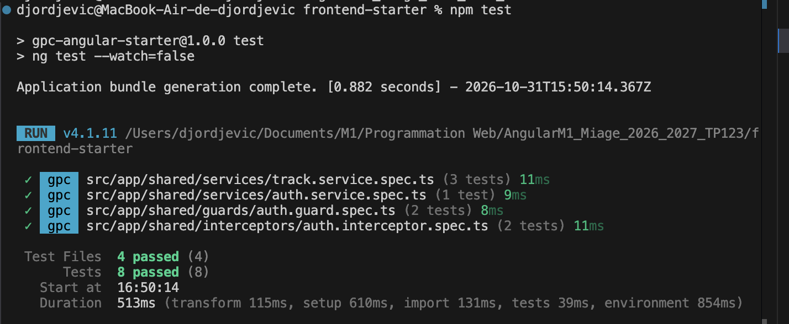

#### Exécution des tests automatisés backend :
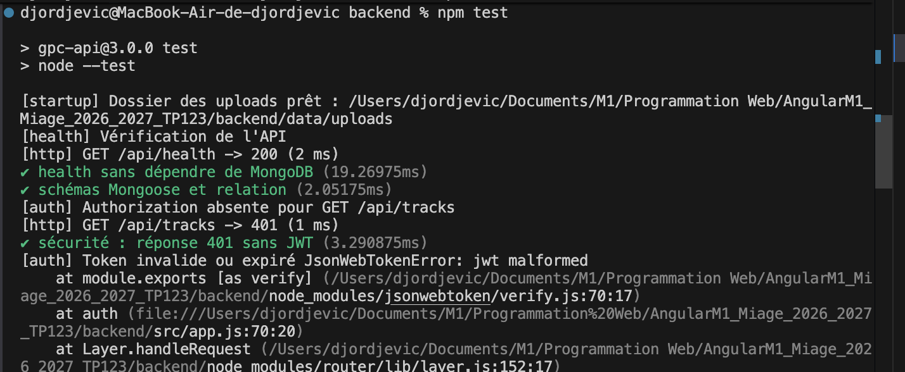

#### Contrôle console et réseau :
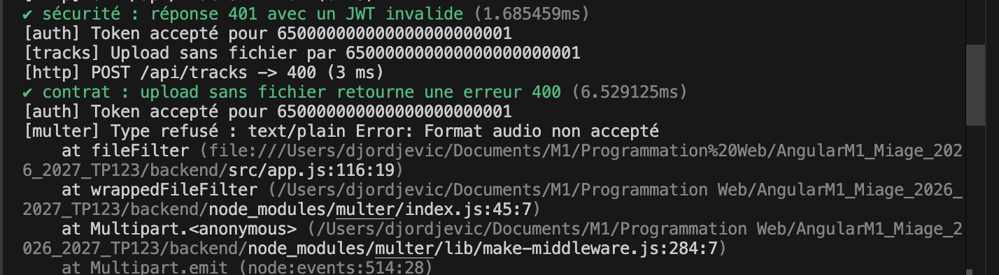

#### Capture de la requête DELETE :
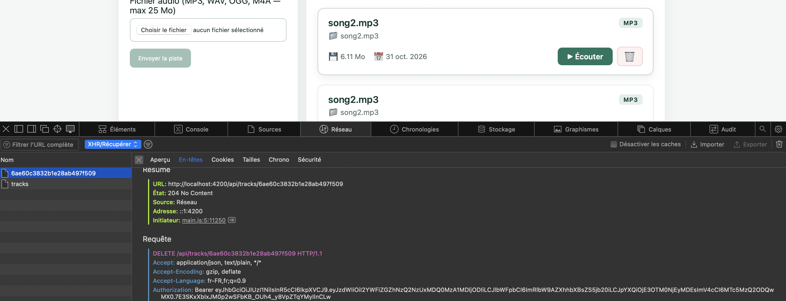

#### Capture Network d'un upload :
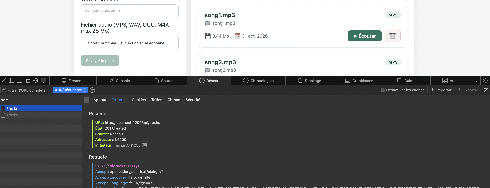 
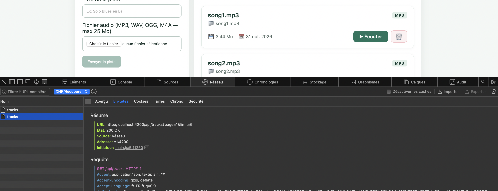

### 8. Ce que je sais maintenant expliquer sans l'agent (Restitution orale)

1. **Pourquoi la suppression passe par un service ?**
   * Pour respecter la séparation des responsabilités : le composant s'occupe uniquement de l'affichage et de l'interaction utilisateur, tandis que le service (`TrackService`) centralise les appels HTTP avec `HttpClient` pour rendre le code réutilisable et facilement testable.

2. **Comment le backend protège la suppression ?**
   * Le backend vérifie le token JWT et extrait l'identifiant de l'utilisateur (`req.auth.sub`). La requête Mongoose filtre à la fois par l'identifiant du morceau et par le propriétaire (`Track.findOneAndDelete({ _id: id, ownerId: req.auth.sub })`), ce qui empêche formellement de supprimer le morceau d'un autre utilisateur.

3. **Comment Angular calcule le pourcentage d’upload ?**
   * Grâce aux options `{ reportProgress: true, observe: 'events' }` passées à `HttpClient`, Angular écoute les événements `HttpEventType.UploadProgress` et calcule le ratio : `Math.round((100 * event.loaded) / event.total)`.

4. **Pourquoi les tests HTTP n’ont-ils pas besoin de MongoDB ou d'un backend actif ?**
   * Parce qu'on utilise `HttpTestingController` (`@angular/common/http/testing`) qui intercepte les requêtes en mémoire avant qu'elles ne partent sur le réseau et renvoie de fausses réponses simulées (`req.flush()`). Les tests sont ainsi ultra-rapides et ne dépendent d'aucune base de données.

5. **Ce que vérifie un test d’intercepteur ou de guard ?**
   * Le test d'intercepteur vérifie que l'en-tête `Authorization: Bearer <token>` est automatiquement injecté dans les requêtes protégées. Le test de guard vérifie qu'un utilisateur non connecté est bloqué et immédiatement redirigé vers `/login`.

6. **Quelle différence existe entre un test unitaire et un test d’intégration ?**
   * Un **test unitaire** teste un composant ou un service isolé en remplaçant toutes ses dépendances par des mocks (bouchons). Un **test d'intégration** vérifie le fonctionnement conjoint de plusieurs briques réelles assemblées (ex: composant avec son template HTML, ses services et le routeur).
