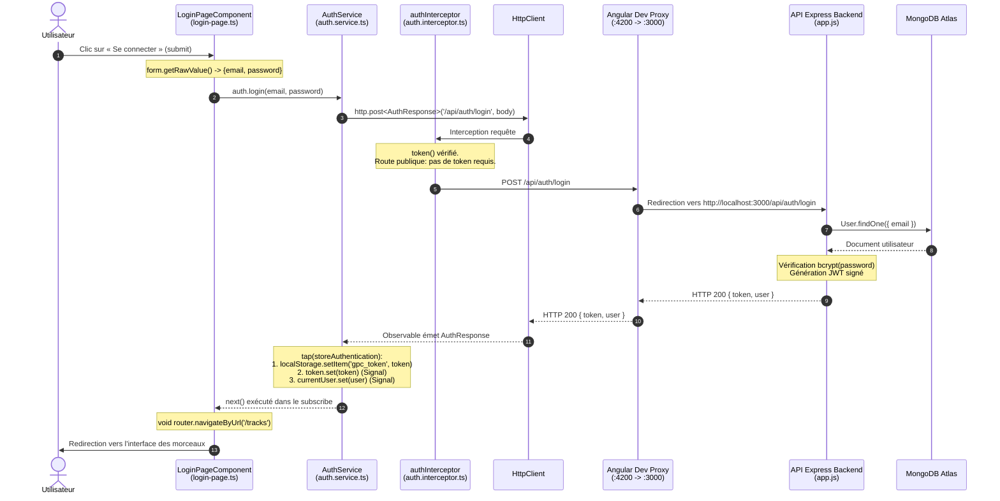
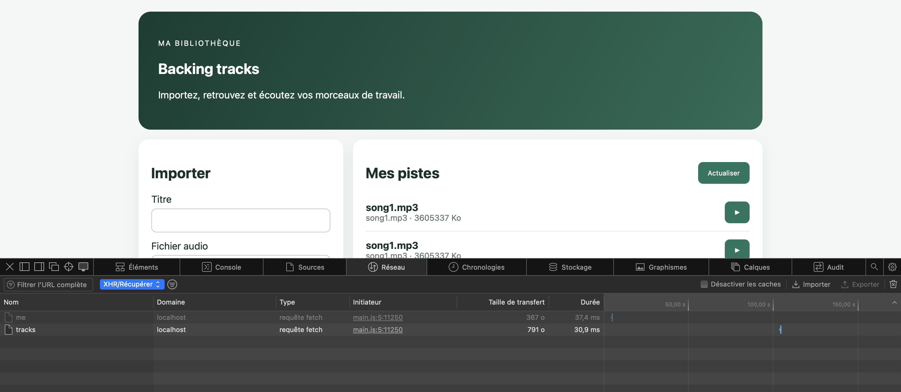
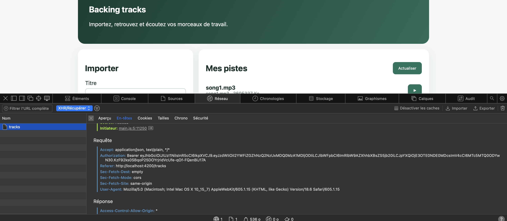
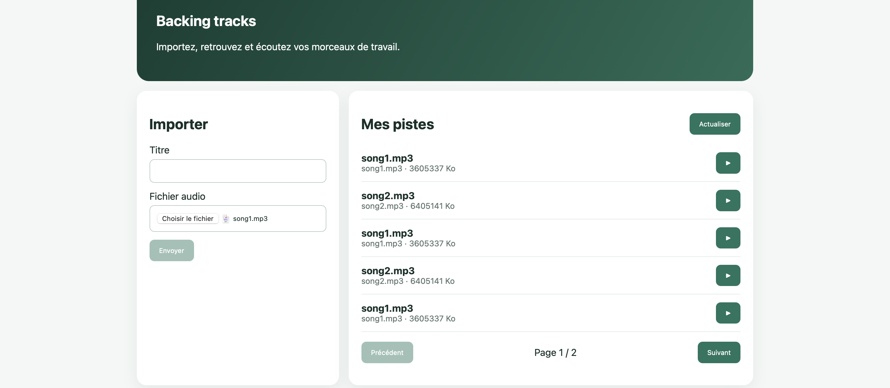
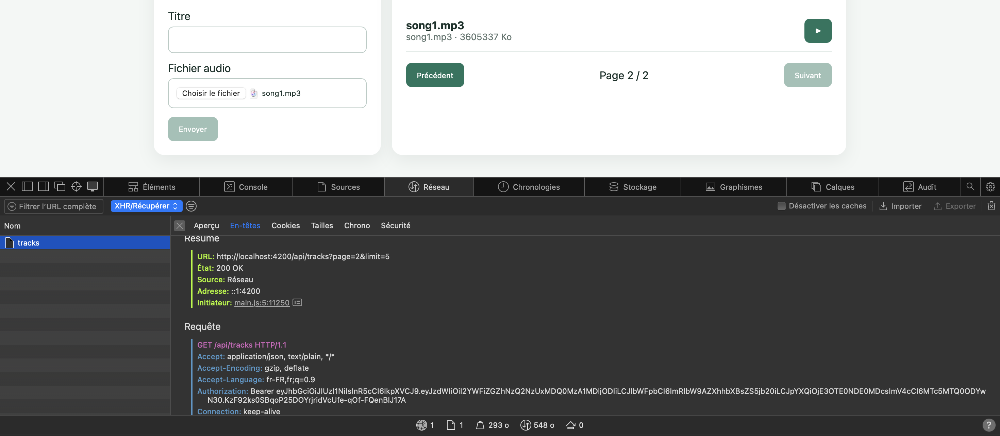
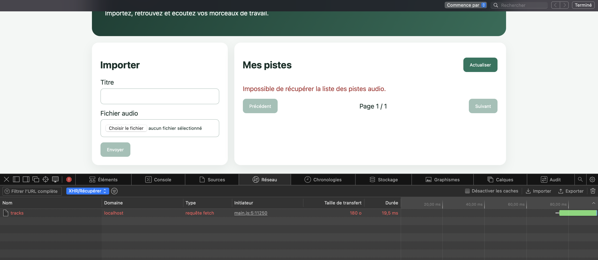
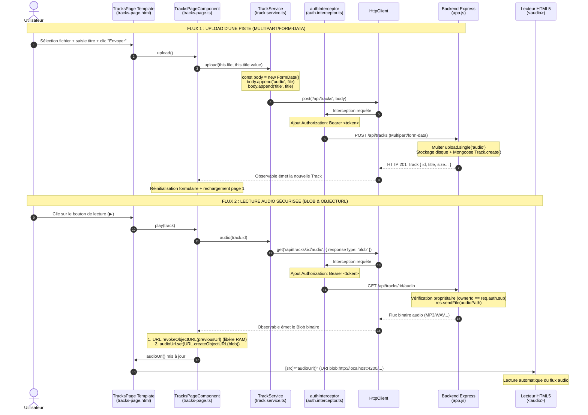

# Rapport d'usage de l'IA — TP1

## Informations générales
* **Binôme** : [Noms / Prénoms des étudiants]
* **Assistant IA utilisé** : Gemini 3.8 Flash (High) dans l'environnement Antigravity IDE
* **Mode d'utilisation** : Pair-programming pas-à-pas avec lecture du projet, proposition de diffs ciblés, validation humaine obligatoire avant application et contrôle par `npm run build`.

---

## Mission 0 — Cartographier l’application

### 1. Objectif
Comprendre l'architecture de départ sans modifier de code : identifier le composant racine, le routage, l'enregistrement de `HttpClient`, l'intercepteur JWT, les modèles et services, et produire le schéma de flux lors de la connexion ainsi que la distinction des routes publiques/protégées de l'API.

### 2. Prompt principal
> "Tu es mon assistant de développement pour ce projet AngularM1. Lis GEMINI.md, best-practices.md, README.md et API_CONTRACT.md. Analyse d'abord le code sans le modifier. Résume les fichiers concernés et le flux composant -> service -> HttpClient -> API. Indique les routes API et les modèles utilisés. Attends ma validation avant modification. Fais-moi Mission 0 Cartographier l'application."

### 3. Plan proposé par l'agent
1. Exploration de l'arborescence (`src/app/components`, `src/app/shared`).
2. Identification des points pivots : `main.ts`, `routes.ts`, `auth.interceptor.ts`, `auth.service.ts`.
3. Synthèse tabulaire des composants, services, modèles et guards.
4. Classification des routes de `API_CONTRACT.md` (publiques vs protégées par JWT).
5. Élaboration du diagramme de séquence Mermaid pour le clic sur « Se connecter ».

### 4. Vérifications réalisées par le binôme
* Contrôle manuel de `main.ts` pour confirmer la présence de `provideHttpClient(withInterceptors([authInterceptor]))`.
* Vérification de `proxy.conf.json` pour s'assurer que `/api` pointe vers `http://localhost:3000`.
* Test de santé de l'API backend : `curl http://localhost:3000/api/health` renvoyant `{"status":"ok"}`.
* Archivage de la synthèse dans le document de référence `TP1Mission0.md`.

### 5. Erreurs ou propositions rejetées
* Aucune modification de code effectuée conformément à la règle stricte d'observation préalable.

### 6. Fichiers consultés (aucun fichier modifié)
* `frontend-starter/src/main.ts`
* `frontend-starter/src/app/routes.ts`
* `frontend-starter/src/app/shared/interceptors/auth.interceptor.ts`
* `frontend-starter/src/app/shared/services/auth.service.ts`
* `frontend-starter/src/app/shared/services/track.service.ts`
* `frontend-starter/src/app/shared/models/*`
* `API_CONTRACT.md`, `README.md`, `backend/src/app.js`

### 7. Preuve de fonctionnement et cartographie détaillée

#### A. Cartographie de l’architecture frontend
| Élément | Emplacement & Description |
| :--- | :--- |
| **Composant racine** | `AppComponent` (`app-root`), défini avec son template `app.html` et son style `app.css`. Il contient l’en-tête commun et le `<router-outlet />`. Démarré dans `main.ts`. |
| **Configuration des routes** | `routes` : fourni au bootstrap via `provideRouter(routes)` dans `main.ts`. Définit `/login`, `/register`, `/profile` (gardé), `/tracks` (gardé) et une redirection par défaut vers `/tracks`. |
| **Enregistrement de HttpClient** | Configuré dans `main.ts` avec :<br/>`provideHttpClient(withInterceptors([authInterceptor]))` |
| **Mécanisme d’injection du JWT** | `authInterceptor` : intercepteur fonctionnel (`HttpInterceptorFn`) qui injecte `AuthService`, lit le signal `token()` et clone la requête avec l’en-tête `Authorization: Bearer <token>` si un token est présent. |

#### B. Pages, Services, Modèles et Guards
* **Pages (Composants) :**
  * `LoginPageComponent` : formulaire de connexion réactif.
  * `RegisterPageComponent` : formulaire d'inscription.
  * `ProfilePageComponent` : affichage et modification du profil.
  * `TracksPageComponent` : liste paginée, upload et lecture audio.
* **Services :**
  * `AuthService` : gère `login()`, `register()`, `profile()`, `update()`, `logout()`, et détient les signals `currentUser` et `token`.
  * `TrackService` : encapsule les appels HTTP pour les pistes (`list()`, `upload()`, `audio()`).
* **Modèles :**
  * `User` (`id`, `name`, `email`, `createdAt`)
  * `AuthResponse` (`token`, `user`)
  * `Track` (`id`, `title`, `originalName`, `mimeType`, `size`, `createdAt`)
  * `Page` (`items`, `page`, `limit`, `total`, `pages`)
* **Guard :**
  * `authGuard` : vérifie `auth.token()` avant d’activer `/profile` ou `/tracks`, sinon redirige vers `/login`.

#### C. Routes API : Publiques vs Protégées (`API_CONTRACT.md`)
Toutes les requêtes sont préfixées par `/api` (redirigées vers le backend via `proxy.conf.json`).

| Statut | Méthode | Route | Corps / Paramètres | Réponse | Modèle associé |
| :--- | :--- | :--- | :--- | :--- | :--- |
| **Publique** | `GET` | `/api/health` | Aucun | `{ status: "ok" }` | — |
| **Publique** | `POST` | `/api/auth/register` | `{ name, email, password }` | `201 { token, user }` | `AuthResponse` |
| **Publique** | `POST` | `/api/auth/login` | `{ email, password }` | `200 { token, user }` | `AuthResponse` |
| **Protégée (JWT)** | `GET` | `/api/users/me` | Aucun *(Header Authorization)* | `200 User` | `User` |
| **Protégée (JWT)** | `PUT` | `/api/users/me` | `{ name }` + Header *Authorization* | `200 User` | `User` |
| **Protégée (JWT)** | `GET` | `/api/tracks` | Query: `?page=1&limit=5` + Header *Authorization* | `200 Page<Track>` | `Page` |
| **Protégée (JWT)** | `POST` | `/api/tracks` | Multipart : `audio`, `title` + Header *Authorization* | `201 Track` | `Track` |
| **Protégée (JWT)** | `GET` | `/api/tracks/:id/audio` | Header *Authorization* | Flux audio (`Blob`) | `Blob` |
| **Protégée (JWT)** | `DELETE` | `/api/tracks/:id` | Header *Authorization* | `204 No Content` | — |

#### D. Schéma annoté du flux lors du clic sur « Se connecter »


### 8. Ce que chaque membre sait expliquer sans l'agent
* Le trajet d'une requête HTTP depuis le composant Angular jusqu'à MongoDB via le service, `HttpClient`, l'intercepteur et le proxy.
* La différence entre route publique (`/api/auth/login`, `/api/auth/register`, `/api/health`) et route protégée par `Authorization: Bearer <token>` (`/api/users/me`, `/api/tracks`).

---

## Mission 1 — Inscription, Connexion et Profil

### 1. Objectif
Compléter la partie utilisateur du frontend :
* Formulaires réactifs pour la connexion et l'inscription avec validations et messages compréhensibles.
* Traitement des appels API, stockage sécurisé du token dans `localStorage` et mise à jour des Signals `token` et `currentUser`.
* Bouton de déconnexion réactif dans le header avec nettoyage complet de l'état local.
* Chargement automatique du profil (`GET /api/users/me`) et mise à jour réactive du nom (`PUT /api/users/me`).
* Gestion globale du statut HTTP `401 Unauthorized` pour rediriger vers `/login` sans fuite de token.

### 2. Prompts principaux
* *"On va aller pas à pas pour la mission 1 on va commencer par ce tiret : formulaires réactifs pour l'inscription et la connexion ; et explique-moi comment t'as fait"*
* *"Validations et messages d'erreur compréhensibles"*
* *"Appels de /api/auth/register et /api/auth/login, sauvegarde du JWT sans fuite dans les logs, mise à jour du Signal currentUser, redirection"*
* *"Bouton de déconnexion avec nettoyage de l'état local"*
* *"Chargement de /api/users/me et modification du nom avec PUT /api/users/me"*
* *"Gestion d'un 401, avec retour vers /login si le token est invalide ou expiré"*

### 3. Plan proposé par l'agent et exécuté pas à pas
1. **Formulaires réactifs** :
   * Typage strict `nonNullable: true` sur les `FormControl`.
   * Validateur `Validators.minLength(8)` sur le mot de passe à l'inscription pour respecter les exigences du backend (`app.js:169`).
   * Garde-fou `if (this.form.invalid) return;` avant toute émission réseau.
2. **Messages d'erreur explicites & Accessibilité** :
   * Conditionnement des messages par `@if (form.controls.<champ>.touched && form.controls.<champ>.errors?.['...'])`.
   * Déclenchement de `markAllAsTouched()` si soumission d'un formulaire incomplet.
   * Ajout des attributs `role="alert"` et `autocomplete` (WCAG AA).
3. **Flux d'authentification** :
   * Exploitation de `tap` dans `AuthService` pour alimenter `localStorage` et les Signals.
   * Redirection via `Router.navigateByUrl`.
4. **Bouton de déconnexion** :
   * Transformation du header de `AppComponent` en barre de navigation conditionnelle réactive (`@if (auth.token())`).
   * Suppression de `gpc_token` et réinitialisation des Signals à `null` lors de `logout()`.
5. **Profil utilisateur** :
   * Appel automatique de `load()` dans le constructeur de `ProfilePageComponent`.
   * Validation du nouveau nom et retours visuels (message de succès et gestion des erreurs).
6. **Gestion globale du 401** :
   * Ajout de `catchError` dans `authInterceptor`.
   * Exclusion de la route `/api/auth/login` pour ne pas masquer les erreurs de saisie d'identifiants.

### 4. Vérifications réalisées par le binôme
* **Build Angular** : exécuté systématiquement après chaque incrément (`npm run build` terminé à chaque fois avec succès en ~1.3s).
* **Onglet Network (DevTools)** :
  1. `POST /api/auth/login` avec identifiants valides (`demo@example.com` / `Demo1234!`) -> Statut `200 OK`, token reçu, redirection `/tracks`.
  2. `POST /api/auth/login` avec mauvais mot de passe -> Statut `401 Unauthorized`, message d'erreur rouge affiché sans redirection intempestive.
  3. `GET /api/users/me` -> Statut `200 OK` avec en-tête `Authorization: Bearer <token>`, chargement automatique des informations.
  4. `PUT /api/users/me` -> Statut `200 OK`, mise à jour immédiate du nom dans l'UI.
* **Onglet Application (DevTools)** :
  * Présence de `gpc_token` lors de la connexion.
  * Disparition immédiate de `gpc_token` au clic sur « Déconnexion ».

### 5. Erreurs ou propositions adaptées
* **Ciblage de l'intercepteur 401** : Initialement, intercepter tous les 401 risquait d'interférer avec le formulaire de login (qui renvoie 401 en cas de mot de passe erroné). Nous avons adapté la condition pour exclure `request.url.includes('/auth/login')`. Ainsi, la tentative de connexion erronée reste gérée localement par le formulaire de connexion, tandis que l'expiration du token sur les routes protégées redirige bien l'utilisateur.

### 6. Fichiers effectivement modifiés
* `frontend-starter/src/app/components/login-page/login-page.ts` : validation submit et `markAllAsTouched`.
* `frontend-starter/src/app/components/login-page/login-page.html` : messages d'erreur ciblés et désactivation bouton.
* `frontend-starter/src/app/components/register-page/register-page.ts` : validateur 8 caractères et `markAllAsTouched`.
* `frontend-starter/src/app/components/register-page/register-page.html` : messages d'erreur ciblés et bouton lié à `form.invalid`.
* `frontend-starter/src/app/components/app/app.ts` : injection `AuthService` et méthode `logout()`.
* `frontend-starter/src/app/components/app/app.html` : affichage conditionnel `@if (auth.token())` et bouton déconnexion.
* `frontend-starter/src/app/components/app/app.css` : styles pour `.btn-logout` et alignement de la navigation.
* `frontend-starter/src/app/components/profile-page/profile-page.ts` : chargement automatique `load()`, signaux `loading`, `success`, `error`.
* `frontend-starter/src/app/components/profile-page/profile-page.html` : formulaire réactif complet, feedback d'enregistrement.
* `frontend-starter/src/app/components/profile-page/profile-page.css` : style `.success`.
* `frontend-starter/src/app/shared/interceptors/auth.interceptor.ts` : gestion centralisée du statut 401 avec déconnexion et redirection.

### 7. Preuve de fonctionnement
* Compilation sans avertissement : `npm run build` (gpc bundle 298 kB).
* Scénario complet testé avec succès dans le navigateur : Inscription d'un nouveau compte -> Redirection profil -> Modification du nom -> Consultation des backing tracks -> Déconnexion -> Tentative d'accès direct à `/tracks` bloquée par `authGuard`.

### 8. Ce que chaque membre sait maintenant expliquer sans l'agent
1. **Différence entre Signal et `localStorage`** :
   * Le `Signal` est réactif et réside en mémoire vive (RAM). Dès qu'il est mis à jour (`set`), les composants et templates qui le lisent se réaffichent immédiatement. Mais il est volatile (perdu au rafraîchissement F5).
   * Le `localStorage` est un stockage persistant sur disque (clé/valeur sous forme de chaîne). Il survit au rafraîchissement de la page, mais n'est pas réactif (sa modification ne déclenche aucun cycle de détection Angular).
   * D'où leur association : `localStorage` conserve le token entre les sessions, et le Signal `token` propage son état réactivement dans l'application.
2. **Localisation de la mise à jour du profil utilisateur** :
   * Côté Front : [ProfilePageComponent](frontend-starter/src/app/components/profile-page/profile-page.ts) (formulaire réactif) -> [AuthService.update()](frontend-starter/src/app/shared/services/auth.service.ts) -> [authInterceptor](frontend-starter/src/app/shared/interceptors/auth.interceptor.ts) (ajoute le token Bearer).
   * Côté Back : [backend/src/app.js](backend/src/app.js) (`app.put("/api/users/me", auth, ...)`) -> middleware `auth` (vérification JWT) -> [User.findByIdAndUpdate()](backend/src/models/User.js) (sauvegarde dans MongoDB Atlas).


---

## Mission 2 — Bibliothèque paginée

### 1. Objectif
Construire une bibliothèque audio robuste avec une pagination gérée intégralement côté serveur :
* Vérifier et documenter `TrackService.list(page, limit)` transmettant `page` et `limit` en query parameters (`GET /api/tracks?page=...&limit=...`).
* Représenter l'ensemble des états avec des **Signals Angular 22** :
  * la liste des pistes `tracks` ;
  * la page courante `page` ;
  * le nombre d'éléments par page `limit` ;
  * le nombre total de pages `pages` ;
  * l'état de chargement `loading` ;
  * l'erreur éventuelle `error`.
* Afficher les pistes avec `@for`, l'état vide avec `@empty`, le chargement avec `@if` et le message d'erreur avec `@if`.
* Mettre en place les boutons « Précédent » et « Suivant », désactivés aux bornes (`page <= 1` et `page >= pages`) et pendant les chargements.
* Garantir qu'un changement de page déclenche une véritable requête HTTP serveur (interdiction stricte de découpage local en mémoire).

### 2. Prompts principaux
* *"Je suis au TP2 donc deja commece par regarder tout les fichiers du projet et respecte les consignes que je te donne et ensuite on va commencer par ma mission 2"*
* *"Oui"* (validation de l'étape 1 sur `tracks-page.ts` et `tracks-page.html`).
* *"mais comment je teste ce que ta fais ?"* (guide de test pas-à-pas avec DevTools Network, multi-pages et simulation d'erreur).

### 3. Plan proposé par l'agent et exécuté pas à pas
1. **Contrôle et documentation de `TrackService`** :
   * Vérification que `list(page, limit)` envoie bien `{ params: { page, limit } }`.
   * Ajout de commentaires pédagogiques détaillés pour M1 expliquant la sérialisation des query parameters et l'injection du JWT par `authInterceptor`.
2. **Refonte réactive de `TracksPageComponent` avec les Signals Angular 22** :
   * Ajout du signal `error = signal<string | null>(null)` manquant dans le starter.
   * Ajout du signal `limit = signal(5)` pour un contrôle explicite du nombre d'éléments par page.
   * Réinitialisation de l'état d'erreur et activation du chargement dans `load()`.
   * Sécurisation de la méthode de navigation `go(targetPage)` : blocage des navigations hors bornes (`targetPage < 1 || targetPage > pages()`) ou pendant qu'une requête est déjà en cours (`loading()`).
3. **Mise à niveau du template `tracks-page.html`** :
   * Affichage réactif de l'erreur via `@if (error())` avec attribut accessible `role="alert"`.
   * Affichage du chargement `@if (loading())`.
   * Itération `@for` et fallback `@empty` protégé pour ne pas s'afficher intempestivement pendant un chargement ou en cas d'erreur.
   * Contrôle des boutons du Pager : « Précédent » et « Suivant » avec liaisons `[disabled]="page() <= 1 || loading()"` et `[disabled]="page() >= pages() || loading()"`.
4. **Vérification de la compilation** : exécution de `npm run build` confirmant un bundle propre de 299 kB.

### 4. Vérifications et captures d'écran réalisées par le binôme

#### A. Chargement initial de la bibliothèque et token JWT
Lors de l'arrivée sur l'application, les requêtes `/api/users/me` et `/api/tracks` sont déclenchées automatiquement.


*Figure 2.1 — Chargement initial de l'interface et requêtes Fetch/XHR associées.*

L'examen de la requête `GET /api/tracks` dans les DevTools montre que le middleware client injecte bien le token JWT dans l'en-tête de requête :


*Figure 2.2 — En-têtes HTTP de la requête de récupération des pistes, avec Authorization Bearer token.*

#### B. Affichage paginé côté client (Page 1)
En important plusieurs pistes de test, la pagination s'active dès que le total dépasse la limite (ici 5 pistes par page) :


*Figure 2.3 — Page 1/2 : affichage des 5 premiers morceaux. Le bouton « Précédent » est bien désactivé à la borne minimale, et « Suivant » est actif.*

#### C. Changement de page et requête serveur (Livrable Network TP2)
Au clic sur « Suivant », la page 2 est chargée. Une nouvelle requête `GET /api/tracks?page=2&limit=5` est émise sur le réseau avec code `200 OK` :


*Figure 2.4 — Page 2/2 : nouvelle requête HTTP GET /api/tracks?page=2&limit=5 dans l'onglet Network (200 OK), bouton « Suivant » désactivé à la borne maximale.*

#### D. Gestion réactive des erreurs réseau
Pour tester la robustesse face aux pannes, le backend a été arrêté temporairement. Au clic sur « Actualiser », le signal `error` capture le rejet de la requête et affiche un message clair sans bloquer l'application :


*Figure 2.5 — Affichage de l'erreur via le signal error() en cas d'indisponibilité du serveur.*

### 5. Erreurs ou propositions adaptées
* **Signal d'erreur omis dans le starter** : Le composant initial se contentait d'un `console.error` sans avertir l'utilisateur. Nous avons introduit le Signal `error` et son rendu avec `@if (error())` pour satisfaire strictement les exigences du sujet.
* **Double-clic et requêtes concurrentes** : Ajout d'une condition `loading()` sur les boutons « Précédent », « Suivant » et « Actualiser » pour empêcher d'envoyer plusieurs requêtes simultanées en cas de clics rapides.

### 6. Fichiers modifiés
* `frontend-starter/src/app/components/tracks-page/tracks-page.ts` : signaux d'état `error` et `limit`, garde-fous de bornes, gestion du flux `subscribe`.
* `frontend-starter/src/app/components/tracks-page/tracks-page.html` : `@if (error())`, libellés des boutons « Précédent » / « Suivant » et sécurisation des états désactivés.
* `frontend-starter/src/app/shared/services/track.service.ts` : documentation pédagogique M1 sur la sérialisation des query params.

### 7. Preuve de fonctionnement
* **Compilation Angular** : `npm run build` réussi sans erreur (temps d'exécution : 1.2s, bundle : 299 kB).
* **Network DevTools** : chaque changement de page génère une requête serveur ciblée (`GET /api/tracks?page=1&limit=5` puis `GET /api/tracks?page=2&limit=5`).
* **Livrables TP2 validés pour cette mission** : capture Network de la pagination fournie (Figure 2.4).

### 8. Ce que chaque membre sait expliquer sans l'agent
1. **Pourquoi paginer côté serveur plutôt que côté client ?**
   * Si la base contient 10 000 morceaux, un découpage frontend obligerait à télécharger les 10 000 objets JSON en mémoire, saturant la bande passante et le navigateur.
   * La pagination serveur avec `skip` et `limit` (MongoDB) ne transfère que les 5 éléments requis pour l'affichage courant, avec une complexité et une empreinte mémoire constantes $O(1)$ côté client.
2. **Comment les paramètres `page` et `limit` transitent-ils ?**
   * Angular `HttpClient` sérialise l'objet `{ params: { page, limit } }` sous forme de chaîne de requête URL (`?page=2&limit=5`).
   * Le backend Express extrait ces valeurs via `req.query.page` et `req.query.limit`, calcule le saut avec `skip((page - 1) * limit)` et renvoie l'objet `Page<Track>` avec le total et le nombre de pages calculé via `Math.ceil(total / limit)`.
## Mission 3 — Analyse et amélioration de l’upload et de la lecture audio

### 1. Objectif
Analyser et fiabiliser la chaîne complète de traitement des fichiers audio :
1. Cartographier précisément le flux d'upload (`FormData`) et de lecture sécurisée (`Blob`, `ObjectURL`, `<audio>`).
2. Comprendre l'intégration du JWT et la nécessité de passer par `HttpClient` plutôt qu'un simple attribut `src`.
3. Répondre aux questions fondamentales sur la mémoire, le buffering du navigateur et le streaming.
4. Ajouter les validations frontend et les retours d'interface (chargement, succès, erreurs, reset).
5. Transformer l'affichage des morceaux en **cards responsives, accessibles et esthétiques**.
6. Sécuriser le cycle de vie du lecteur audio (nettoyage avec `URL.revokeObjectURL` à la destruction).

---

### 2. Analyse du flux existant et cartographie du code

#### A. Tableau des fichiers et méthodes impliqués

| Action | Fichier | Méthode / Élément | Rôle technique |
| :--- | :--- | :--- | :--- |
| **Choix du fichier** | `tracks-page.html`<br/>`tracks-page.ts` | `<input type="file" (change)="choose($event)">`<br/>`choose(event)` | Écoute l'événement DOM `change` et extrait le fichier binaire sélectionné via `(event.target as HTMLInputElement).files?.[0]`. |
| **Construction du FormData** | `track.service.ts` | `TrackService.upload(file, title)` | Crée une instance de `FormData` et y injecte le fichier sous la clé `audio` et le libellé sous la clé `title`. |
| **Appel HTTP d'upload** | `track.service.ts`<br/>`tracks-page.ts` | `this.http.post<Track>('/api/tracks', body)`<br/>`upload()` | Envoie la requête multipart au backend via `HttpClient`. L'intercepteur `authInterceptor` y injecte automatiquement le header `Authorization: Bearer <token>`. |
| **Récupération du Blob** | `track.service.ts` | `TrackService.audio(id)` | Émet un `GET /api/tracks/:id/audio` avec l'option `{ responseType: 'blob' }`. Indique à Angular de ne pas interpréter la réponse en JSON mais de capturer le flux binaire brut sous forme d'objet JavaScript `Blob`. |
| **Révocation de l'ancienne URL** | `tracks-page.ts` | `play(track)` | Appelle `URL.revokeObjectURL(previousUrl)` pour libérer immédiatement de la mémoire du navigateur le blob précédemment alloué. |
| **Création de l'ObjectURL** | `tracks-page.ts` | `play(track)` | Exécute `URL.createObjectURL(blob)`, générant une URI locale pointant vers les octets en mémoire (ex: `blob:http://localhost:4200/5b94...`). |
| **Affectation au lecteur audio** | `tracks-page.html` | `<audio [src]="audioUrl()" controls autoplay>` | Lie l'URL locale générée à la propriété `src` de la balise HTML5 native `<audio>` via le Signal `audioUrl()`. |

---

#### B. Schéma annoté des deux grands flux



---

#### C. Pourquoi une URL directement placée dans `<audio src="...">` ne reçoit pas automatiquement le JWT ?

Si l'on écrivait directement dans le template :
```html
<audio src="/api/tracks/123/audio" controls></audio>
```
La requête audio **échouerait immédiatement avec une erreur HTTP 401 Unauthorized**.

* **Explication technique** :
  1. Lorsqu'un navigateur rencontre une balise HTML avec un attribut `src` (`<audio>`, ``, `<video>`, `<script>`), c'est le **moteur de rendu natif du navigateur** qui émet la requête HTTP GET correspondante, en dehors de l'application JavaScript / Angular.
  2. L'intercepteur Angular (`authInterceptor`) n'intercepte **que** les requêtes émises programmatiquement via la classe `HttpClient` d'Angular (`this.http.get(...)`).
  3. Le standard HTML ne permet pas d'ajouter des en-têtes HTTP personnalisés (comme `Authorization: Bearer <token>`) sur une balise `<audio src="...">`.
  4. Pour sécuriser un flux audio privé avec un token JWT, la seule solution est donc :
     * D'utiliser `HttpClient` pour émettre la requête avec le token d'authentification (`responseType: 'blob'`).
     * De recevoir les octets en mémoire dans un objet `Blob`.
     * De générer une URL locale en mémoire grâce à `URL.createObjectURL(blob)` (`blob:http://localhost:4200/uuid`).
     * De transmettre cette URL locale à la balise `<audio>`, qui peut alors lire les octets sans avoir besoin de contacter le serveur à nouveau.

---

### 3. Contrôles de validation : Backend vs Frontend

#### A. Contrôles identifiés dans le code Backend (`backend/src/app.js`)
1. **Présence du fichier** : Vérifié à la ligne 340 (`if (!req.file) return res.status(400).json({ message: "Fichier audio requis" });`).
2. **Champ titre** : Lu à la ligne 347 (`title: req.body.title || req.file.originalname`).
3. **Formats audio acceptés** : Configuré dans Multer via `fileFilter` (lignes 34-41 et 109-119), avec un `Set` strict : `audio/mpeg` (MP3), `audio/wav`, `audio/x-wav`, `audio/ogg`, `audio/mp4`, `audio/x-m4a`. Tout autre type MIME lève une erreur `Format audio non accepté`.
4. **Taille maximale** : Protégée par Multer via `limits: { fileSize: MAX_FILE_SIZE }` (ligne 31, fixée à `25 * 1024 * 1024` octets = 25 Mo).

#### B. Pourquoi la validation Frontend améliore l'expérience mais ne remplace JAMAIS le Backend ?
* **Rôle de la validation Frontend (UX & Économie réseau)** :
  Elle intervient instantanément sur la machine du client, avant tout transfert réseau. Si un utilisateur sélectionne un fichier vidéo de 2 Go ou un PDF, l'erreur apparaît en quelques millisecondes, sans consommer inutilement de la bande passante ni faire attendre l'utilisateur pendant un upload voué à l'échec.
* **Nécessité absolue de la validation Backend (Sécurité)** :
  Le code frontend s'exécute dans un environnement non fiable (le navigateur du client). Un attaquant ou un utilisateur malveillant peut contourner toutes les vérifications Angular en utilisant un outil comme cURL, Postman ou un script Python, ou en modifiant le code via la console du navigateur. Le backend est la seule frontière de sécurité garantissant l'intégrité de la base de données et du système de fichiers du serveur.

---

### 4. Réponses aux questions fondamentales sur la mémoire, le buffering et le streaming

#### Question 1 : Le backend envoie-t-il le fichier entier en mémoire ou peut-il l’envoyer progressivement depuis le disque ?
> **Réponse** : Le backend Express utilise `res.sendFile(audioPath)` (ligne 394 de `app.js`). En interne, la méthode `sendFile` d'Express repose sur les flux Node.js (`fs.createReadStream`). Le fichier audio n'est **jamais chargé intégralement en mémoire RAM du serveur**. Il est lu par blocs (chunks) depuis le disque dur et acheminé progressivement au socket réseau. Cela garantit que le serveur ne subit pas de pic mémoire, même si des dizaines d'utilisateurs téléchargent de gros fichiers simultanément.

#### Question 2 : Avec `HttpClient` et `responseType: "blob"`, à quel moment le composant reçoit-il généralement le fichier ?
> **Réponse** : Le composant reçoit le fichier **uniquement lorsque le téléchargement HTTP est achevé à 100%**. En effet, avec l'option `responseType: 'blob'`, Angular attend que le navigateur ait reçu la totalité des octets de la réponse HTTP pour assembler l'objet JavaScript `Blob` en mémoire et déclencher le callback `next(blob)` du `subscribe`. Il n'y a donc pas de lecture progressive pendant le téléchargement à travers ce mécanisme.

#### Question 3 : Si la bibliothèque contient 100 morceaux, les 100 fichiers audio sont-ils chargés en mémoire dès l'affichage de la liste ? Justifier la réponse à partir du code.
> **Réponse** : **Non, absolument pas.** 
> * **Justification dans le code** : L'appel de chargement de la bibliothèque `TrackService.list()` exécute `GET /api/tracks`, qui ne renvoie que des objets JSON contenant des métadonnées légères (`id`, `title`, `size`, `createdAt`). Le fichier audio binaire lui-même n'est demandé au serveur que lors de l'appel à `TrackService.audio(track.id)`, déclenché de manière paresseuse (*lazy*) exclusivement quand l'utilisateur clique sur le bouton de lecture d'une piste spécifique (`play(track)`).

#### Question 4 : Quelle différence y aurait-il avec 100 éléments `<audio>` utilisant directement une URL HTTP ?
> **Réponse** : Si le template contenait 100 balises `<audio src="...">`, le navigateur tenterait pour chacune d'établir une connexion HTTP afin d'analyser les en-têtes du flux, inspecter la durée et le codec audio, voire précharger le début du fichier selon la politique de préchargement du navigateur (`preload`). Cela entraînerait 100 requêtes HTTP concurrentes, saturant la bande passante et le serveur Express, alors même que l'utilisateur ne souhaite généralement en écouter qu'un seul.

#### Question 5 : Pourquoi l'URL créée par `URL.createObjectURL` doit-elle être révoquée ?
> **Réponse** : Chaque exécution de `URL.createObjectURL(blob)` enregistre dans la table interne du navigateur une référence permanente reliant l'URL générée (`blob:...`) aux octets du fichier en mémoire vive (RAM). Tant que cette URL existe, le ramasse-miettes (*Garbage Collector*) de JavaScript est **incapable de libérer la mémoire occupée par le Blob**, même si la variable JavaScript locale n'est plus utilisée. L'appel explicite à `URL.revokeObjectURL(url)` rompt cette liaison et permet au navigateur de libérer immédiatement la mémoire vive, évitant ainsi des fuites de mémoire (*memory leaks*) au fil des écoutes successives.
